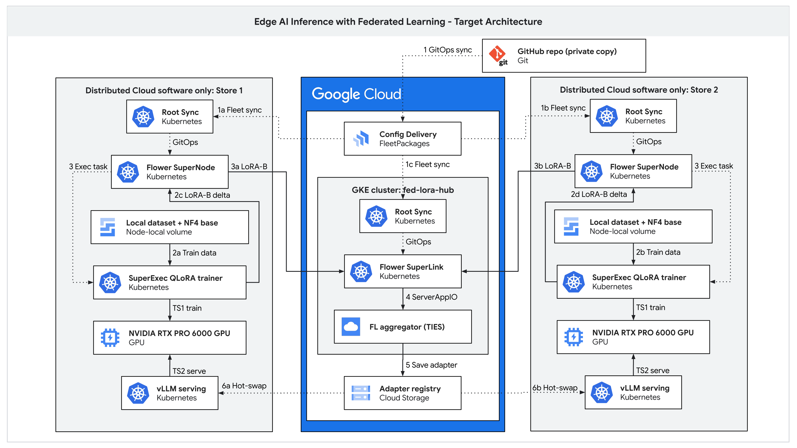

<!--
Copyright 2026 Google LLC

Licensed under the Apache License, Version 2.0 (the "License");
you may not use this file except in compliance with the License.
You may obtain a copy of the License at

    http://www.apache.org/licenses/LICENSE-2.0

Unless required by applicable law or agreed to in writing, software
distributed under the License is distributed on an "AS IS" BASIS,
WITHOUT WARRANTIES OR CONDITIONS OF ANY KIND, either express or implied.
See the License for the specific language governing permissions and
limitations under the License.
-->

# Edge-to-Cloud Federated Learning (Fed-LoRA) Solution Repository

Declarative GitOps repository and turnkey demonstration suite for the
**Edge-to-Cloud Federated Learning (Fed-LoRA) Proof-of-Concept** across **Google
Distributed Cloud (GDC) Software-Only** edge clusters and a Central **Google
Kubernetes Engine (GKE)** aggregator cluster.

This repository provides the complete declarative infrastructure manifests,
continuous delivery pipelines, pre-flight verification tooling, and interactive
demonstration runners for enterprise privacy-preserving AI adaptation.

---

## Disclaimer

This is not an officially supported Google product. This project is provided for
reference and educational purposes only, on a best-effort basis, with no
official support and no service level agreement (SLA). It is not eligible for
the
[Google Open Source Software Vulnerability Rewards Program](https://bughunters.google.com/open-source-security).

## Model license notice

This solution does not include model weights. You must obtain the model you
deploy yourself and comply with its license, specifically the
[Gemma Terms of Use](https://ai.google.dev/gemma/terms) before deploying Gemma 4
weights in your environment.

---

## 1. Solution Architecture & Business Overview

### The Enterprise Challenge: Distributed Retail Privacy

Multi-location retail enterprises (the "Supermarket") face strict regulatory and
compliance barriers (GDPR, CCPA, PCI-DSS) that prohibit aggregating customer
Point-of-Sale (POS) transactions into a central data warehouse. When fine-tuning
generative AI models to localized store-specific data or human operator
feedback, organizations need a mechanism to collaboratively train foundation
models locally without moving raw training data over WAN connections.

### The Solution: Decentralized Federated LoRA (Fed-LoRA)

To resolve this dilemma, the solution implements a **Decentralized Federated
Learning architecture powered by the Flower framework**, decoupling the
orchestration and execution of AI workloads across hybrid infrastructure:

- **Central Cloud (GKE):** Deploys the centralized **Flower SuperLink** control
  plane exposing the `FleetAPI` (gRPC :9092 for outbound edge node long-polling)
  and `ExecAPI` (gRPC :9093 for CLI control plane orchestration) alongside the
  centralized **ServerApp** aggregation logic.
- **Hybrid Edge (GDC Software-Only):** Runs **Flower SuperNodes** as
  long-running edge worker daemons establishing persistent outbound-only
  long-polling to SuperLink, executing the **ClientApp** locally with zero
  inbound edge firewall penetrations.
- **Flower App (`apps/fed-lora`):** Decoupled application package containing a
  dual-mode **ServerApp** (orchestrating both siloed `local-sft` and federated
  `FedAvg` aggregation rounds) and an edge **ClientApp** (managing local
  FFA-LoRA fine-tuning and dynamic vLLM adapter injection).

#### Key Tenets of the Solution

- **Local Data Sovereignty:** Raw store training datasets remain permanently on
  each store node's local Persistent Volume (`PVC` at
  `/mnt/models/edge-data/store-{1,2}/train.jsonl`). In the demonstration lab,
  each store's dataset is seeded declaratively (`ConfigMap/store-training-data`
  $\rightarrow$ `PVC` via `seed-store-training-data` initContainer); in
  production, the file is produced directly by the store's own local POS/edge
  systems. The central Cloud Storage bucket holds model artifacts (aggregated
  adapter checkpoints) only.
- **Co-Located Inference & Local PEFT:** Gemma 4 model inference on vLLM and
  local Parameter-Efficient Fine-Tuning (PEFT based on QLoRA) using Hugging Face
  PEFT, Transformers, BitsAndBytes, and PyTorch libraries (with co-located GPU
  resources via NVIDIA GPU Operator).
- **Parameter-Only Federation:** Only lightweight LoRA rank-16 weight matrices
  (less than 7 MB) travel across the Edge-to-Cloud network (WAN) via encrypted
  gRPC to the central GKE aggregator.
- **Dynamic Hot-Swapping:** Centralized parameter averages (`FedAvg`) are
  synthesized into global adapters and injected dynamically into edge vLLM
  serving engines in `< 100 ms` with zero serving downtime.

### Target Architecture



📄 A vector copy for zoom is available at
[`docs/images/fed-lora_architecture_diagram.pdf`](docs/images/fed-lora_architecture_diagram.pdf).

---

## 2. Five-Stage Demonstration Lifecycle

The following workflow aims at demonstrating the key tenets of this Federated
Learning solution using Flower framework within a simulated environment with 2
Edge Clusters in Store (GDC software-only clusters) and 1 Central Aggregator
(GKE Cluster).

### Learning & Federation Objectives

The primary objective of this solution is to prove that multi-location retail
enterprises can collaboratively train and adapt foundation models to local store
policies and domain knowledge while maintaining absolute data sovereignty:

- **Local Data Sovereignty:** Each store trains a specialized LoRA adapter
  locally on its private store policy (Fact A or Fact B) using local edge
  compute, ensuring raw POS datasets never leave the edge perimeter.
- **Collaborative Cross-Silo Transfer:** Through Central Federated Learning
  parameter aggregation (**Energy-Balanced Cross-Subspace Residual Projection
  (`subspace_resid`)** at $\gamma = 0.85$ with inverse-energy balancing
  `gains=1.40x/1.30x`), the parameter deltas ($\Delta W$) from both stores are
  merged into a unified collaborative global adapter (`||B_merged||_F = 19.44`)
  without single-silo dilution or shared-refusal amplification.
- **Two-Layer Hallucination Control & Zero-VRAM Edge Judge:** Local QLoRA
  training uses `KLProxTrainer` (`kl_beta=0.15` via zero-VRAM
  `model.disable_adapter()`) to prevent memorization collapse, while a
  decentralized **Zero-VRAM Base-Model Judge** (`eval_local_gemma_judge.py`) and
  **Transactional Two-Phase Canary Quarantine (`candidate/` $\rightarrow$
  `promoted/`)** gate adapter promotion against a locked 14-probe canary suite
  (`C1`–`C6`, achieving **`14/14 [100.00%] -> PROMOTE`**).
- **Mutual Knowledge Acquisition:** As a result, both stores acquire knowledge
  of both policies without moving raw training data over WAN connections.

### Domain Knowledge Facts

- **Fact A (Store 1: 45-day return policy with digital POS receipt):** Private
  store return policy exclusive to Store 1 (plus holiday extension through
  January 31).
- **Fact B (Store 2: STORE-VIP-99 VIP discount code):** Secret VIP discount
  promo code (`STORE-VIP-99` for 25% off bakery and specialty grocery orders
  over $50; appliances and apparel excluded) exclusive to Store 2.

The Flower App package (`apps/fed-lora`) and edge SuperNodes are pre-deployed
and instantiated across all clusters prior to Stage 1. The demonstration then
proceeds through 5 core verification and execution stages (plus Stage 0 / Stage
6 `.fab` OCI vs. `.fab` bundle comparison):

1.  **Stage 1 — Base Foundation Model Baseline Verification (`10/10`):** \
    Proves that the un-tuned base foundation model (`google/gemma-4-E2B-it`) is
    ignorant of both private store return policies (Fact A) and secret VIP
    discounts (Fact B) while answering general math/geography prompts
    accurately.
2.  **Stage 2 — Siloed Local Fine-Tuning Execution (`KLProxTrainer`):** \
    Triggers local fine-tuning based on local store data (`20` active curated
    examples/store from `50` total seeded examples: domain + boundary, OOD
    abstention, general replay) from the Central Aggregator via
    `flwr run apps/fed-lora gke-superlink --run-config mode="local-sft"`. Edge
    `SuperExec` GPU trainer pods (`flwr-trainer`) place vLLM into Level-1 Sleep
    Mode (`POST /sleep?level=1`), execute 4-bit QLoRA
    (`r=16, alpha=64, lr=2e-4`), wake vLLM (`POST /wake_up`), and hot-swap local
    adapters dynamically into vLLM.
3.  **Stage 3 — Pre-Federation Siloed QA & Canary Verification
    (`4/4 cURL + 100% Local Canary`):** \
    Proves asymmetric siloed knowledge: Store 1 knows Fact A (`100%` local
    domain canary) and politely abstains on Fact B; Store 2 knows Fact B (`100%`
    local domain canary) and politely abstains on Fact A
    (`ABSTAINED [PASS ✅]`).
4.  **Stage 4 — Federated Cross-Subspace Residual Projection & Two-Phase Canary
    Promotion (`3 Rounds`):** \
    Triggers 3-round federated aggregation via
    `flwr run apps/fed-lora gke-superlink --run-config 'mode="federated" num-server-rounds=3'`.
    SuperNodes initialize from `<1ms` server-side `round-0` `initial_parameters`
    and stream `lora_B` tensors (~7 MB) over outbound gRPC to Central SuperLink
    (`:9092`). `ServerApp` applies **Energy-Balanced Cross-Subspace Residual
    Projection (`subspace_resid`)**
    ($B_{\text{merged}}(\gamma) = \hat{R} + g_1
    \hat{F}_1 + g_2 \hat{F}_2$ at
    $\gamma = 0.85$, `gains=1.40x/1.30x`, `||B_merged||_F = 19.44`), writes
    candidate weights to quarantine
    (`adapters/gemma4-e2b/candidate/round-{1,2,3}/`), evaluates candidate slot
    `store-fed-lora-candidate` via the decentralized 14-probe judge, and
    atomically promotes `store-fed-lora-promoted` into `promoted/latest/` and
    vLLM upon `verdict="PROMOTE"` (`14/14 [100.00%]`).
5.  **Stage 5 — Post-Federation Collaborative QA & Hallucination Control
    Verification:** \
    Queries both stores across all 4 canonical prompts (`4/4 = 100%`) plus the
    14-probe locked canary suite (`100%` on `C1`/`C2` local retention, `100%` on
    `C3` cross-silo transfer, `100%` on `C4` OOD abstention, `100%` on `C5`
    general capability, `0%` fabrication on `C6`,
    **`14/14 [100.00%] -> PROMOTE`** overall Tiered Gate across all 3 rounds in
    `Run 4` `15989409084762325520`).

---

## 3. Demo Artifacts Structure

```text
├── README.md                                   # Root solution overview & quickstart
├── apps/                                       # Decoupled Flower App definitions
│   └── fed-lora/                               # Fed-LoRA Flower App Package
│       ├── pyproject.toml                      # App manifest & federation configs (gke-superlink)
│       ├── serverapp.py                        # Dual-mode ServerApp (local-sft & federated subspace_resid)
│       └── clientapp.py                        # FFA-LoRA ClientApp with vLLM Sleep/Wake & hot-swapping
├── base/                                       # [DRY] Canonical Kustomize components
│   ├── credentials/                            # Fleet Workload Identity & AR pull secret CronJob
│   ├── flwr-client/                            # Co-located edge worker daemon & GPU trainer Deployments
│   ├── flwr-server/                            # Central GKE Flower aggregator Deployment & ILB Service
│   ├── monitoring/                             # Edge Stackdriver CR & GMP PodMonitoring CRDs
│   └── vllm-serving/                           # Namespace, Base vLLM Deployment & shared-model-pvc
├── config/                                     # Environment templates & Cloud Monitoring dashboard JSON
│   ├── .env.example                            # Placeholder environment template
│   ├── fed_lora_env.sh                         # Environment loader & Connect Gateway helper
│   └── monitoring/                             # 4-quadrant Cloud Monitoring dashboard definition
├── docker/                                     # Container image definitions & Cloud Build pipeline
│   ├── Dockerfile.superlink                    # Central Flower SuperLink container image
│   ├── Dockerfile.trainer                      # Edge QLoRA / vLLM trainer container image
│   └── cloudbuild-images.yaml                  # Cloud Build config pushing to YOUR_AR_REPO
├── overlays/                                   # [DRY] Cluster-specific customization overlays & datasets
│   ├── store-1/                                # Store 1 VIP (10.200.0.131), environment & data/train.jsonl
│   ├── store-2/                                # Store 2 VIP (10.200.0.163), environment & data/train.jsonl
│   └── central-aggregator/                     # Central GKE aggregator overlay
├── prerequisites/                              # One-time Phase A platform-admin cluster prerequisites
│   └── gpu-time-slicing/                       # GPU Time-Slicing ConfigMap, ClusterPolicy & detach guide
├── fleet-package/                              # [WET] Multi-document Config Delivery bundles & specs
│   ├── configdelivery-rbac.yaml                # Namespace-scoped Role/RoleBinding for Config Delivery SA
│   ├── environments/                           # store-1, store-2, central-aggregator (manifests.yaml)
│   ├── fleetpackage-central.yaml               # Central GKE aggregator FleetPackage specification
│   ├── fleetpackage-edge.yaml                  # Edge store clusters FleetPackage specification
│   └── render.sh                               # Deterministic Kustomize-to-FleetPackage renderer
├── docs/                                       # Solution documentation & demo runbooks
│   ├── images/                                 # Architecture diagrams & schematics
│   │   ├── fed-lora_architecture_diagram.png   # High-resolution Target Architecture diagram (3000 x 1688)
│   │   └── fed-lora_architecture_diagram.pdf   # Vector PDF copy of the same diagram (for zoom)
│   ├── fed-lora_poc_implementation_guide.md    # End-to-end lab deployment & verification guide
│   ├── fed-lora_poc_demo_script.md             # Master demo runbook & interactive talking points
│   ├── verify_demo_setup_cheat_sheet.md        # Quick reference setup cheat sheet (25 checks)
│   ├── demo_script_cheat_sheet.md              # 5-stage demo & reset manual CLI cheat sheet
│   └── demo_runner_transcript.md               # 5-stage demo execution transcript & reference output
└── scripts/                                    # Automated execution & verification tooling
    ├── render_fleet_manifests.sh               # Kustomize-to-FleetPackage renderer & zero-drift checker
    ├── apply_cluster_secrets.sh                # Out-of-band Secret bootstrapper (hf-token-secret & ar-pull-secret)
    ├── stage_gcs_data.sh                       # GCS checkpoint bucket & Two-Phase Canary prefix bootstrapper
    ├── build_and_stage_fab.sh                  # Stage 0 Flower .fab bundle builder & SHA-256 provenance verifier
    ├── verify_demo_setup.sh                    # Pre-flight readiness audit (25 checks)
    ├── verify_stage1_baseline.sh               # Stage 1 base model ignorance audit
    ├── run_stage2_local_sft.sh                 # Stage 2 siloed local QLoRA fine-tuning runner
    ├── verify_stage3_siloed_qa.sh              # Stage 3 pre-federation siloed QA audit
    ├── run_stage4_fedavg.sh                    # Stage 4 federated parameter aggregation runner
    ├── verify_stage5_federated_qa.sh           # Stage 5 post-federation collaborative QA audit
    ├── run_stage6_fab_showcase.sh              # Stage 6 OCI FleetPackage vs Flower .fab bundle showcase
    ├── run_full_5stage_demo.sh                 # Master dual-mode 5-stage interactive runner
    ├── demo_runner.sh                          # Canonical CLI wrapper delegating to run_full_5stage_demo.sh
    └── reset_demo_to_stage1.sh                 # Clean baseline reset script (< 20s)
```

---

## 4. Deployment Guide & GitOps Architecture

The Fed-LoRA demonstration environment leverages a declarative, multi-cluster
GitOps deployment model to provision infrastructure, alongside a decentralized
runtime application architecture for dynamic fine-tuning and weight aggregation.

### 4.1. Declarative GitOps via Google Cloud Config Delivery (`FleetPackage`)

All cluster-side Kubernetes manifests are authored under `base/` and
`overlays/`, and deterministically rendered into `fleet-package/` via
`./fleet-package/render.sh` (verified with
`./scripts/render_fleet_manifests.sh --check`):

- **Continuous Reconciliation (Private GitHub Repository Copy):** Because Google
  Cloud Config Delivery does not substitute `YOUR_*` placeholders automatically
  at rollout time, operators substitute `YOUR_*` values in a **private** GitHub
  repository copy, re-render
  `fleet-package/environments/{store-1,store-2,central-aggregator}/manifests.yaml`
  via `./fleet-package/render.sh`, push an immutable release tag (`v1.0.0`), and
  connect that private repository through a Cloud Build 2nd-generation GitHub
  connection (`YOUR_CONNECTION` / `YOUR_REPOSITORY` in `us-central1`) referenced
  by `fleet-package/fleetpackage-central.yaml` and
  `fleet-package/fleetpackage-edge.yaml` (after applying
  `fleet-package/configdelivery-rbac.yaml` on each target cluster and building
  trainer/superlink images with `docker/cloudbuild-images.yaml`).
- **Phase A Cluster Prerequisite — NVIDIA GPU Time-Slicing
  (`prerequisites/gpu-time-slicing/`):** Cluster-wide NVIDIA GPU Operator
  policies (`ConfigMap/time-slicing-config` in `gpu-operator` and
  `ClusterPolicy/cluster-policy`, partitioning each single-GPU node into `2`
  slices) live outside the `FleetPackage` under
  `prerequisites/gpu-time-slicing/` and are applied once by the platform
  administrator (`kubectl apply -k prerequisites/gpu-time-slicing`; skip on
  multi-GPU nodes). If upgrading a live cluster where an older `FleetPackage`
  previously owned GPU time-slicing, annotate both live objects with
  `client.lifecycle.config.k8s.io/deletion=detach` before rollout (see
  [`prerequisites/gpu-time-slicing/README.md`](prerequisites/gpu-time-slicing/README.md)).
- **Static Application Footprint (`FleetPackage`):** GitOps manages static
  application resources (`deletionPropagationPolicy: FOREGROUND`):
  - Edge `fed-lora-poc` namespace and shared model storage PVC
    (`shared-model-pvc`).
  - vLLM foundation model serving (`vllm-gemma4`,
    `strategy.type: RollingUpdate (maxSurge: 0, maxUnavailable: 1)`, 64Gi RAM,
    `--enable-sleep-mode`, `VLLM_SERVER_DEV_MODE=1`).
  - Flower SuperNode worker daemons (`flwr-supernode` CPU control plane) and
    pre-baked GPU `SuperExec` trainer pods (`flwr-trainer`).
  - Fleet Workload Identity credentials (`ConfigMap/fleet-wi-credentials-config`
    and `CronJob/ar-pull-refresher` using `python:3.12-slim` to refresh
    `ar-pull-secret` every 30 minutes) plus `Stackdriver` and `PodMonitoring`
    observability resources.
  - Central Flower SuperLink aggregator (`flwr-superlink` on GKE with internal
    LoadBalancer `10.200.0.50` restricted to edge store CIDRs via
    `spec.loadBalancerSourceRanges: [YOUR_STORE_CIDR]`).

### 4.2. Runtime Dynamic Fine-Tuning & Adapter Hot-Swapping

In contrast to static cluster provisioning, fine-tuning execution and parameter
exchange are entirely driven at runtime through Flower:

- **Decoupled Application:** The complete training and federation logic is
  packaged inside `apps/fed-lora/` (`pyproject.toml`, `serverapp.py`,
  `clientapp.py`).
- **Central Dispatch:** Execution is initiated centrally using Central
  Aggregator CLI or API via
  `flwr run apps/fed-lora gke-superlink --run-config mode="..."`.
- **Outbound Communication:** Edge SuperNodes connect outbound to SuperLink over
  gRPC (port 9092). No inbound edge ports are opened, and no `kubectl exec`
  commands are issued to edge clusters during federated runs.
- **Sub-100ms Hot-Swapping:** Once local fine-tuning or global aggregation
  finishes, the edge worker wakes vLLM (`POST /wake_up`) and calls vLLM's
  `/v1/load_lora_adapter` API over the local cluster network. New adapters
  activate in `< 100 ms` without restarting containers or interrupting serving.

### 4.3. Configuration Placeholders & Flower `run-config`

Replace these placeholders in your private GitOps repository copy or rendered
release bundle before deploying (never commit real environment values to a
public fork):

<!-- mdformat off -->

| Placeholder               | Description                                                                                                     |
| :------------------------ | :-------------------------------------------------------------------------------------------------------------- |
| `YOUR_PROJECT_ID`         | Google Cloud fleet host project ID                                                                              |
| `YOUR_PROJECT_NUMBER`     | Numeric Google Cloud fleet host project number (for `fleet-package/configdelivery-rbac.yaml`)                   |
| `YOUR_CONNECTION`         | Cloud Build 2nd-generation GitHub connection name in `us-central1`                                              |
| `YOUR_REPOSITORY`         | Linked private GitHub repository resource name inside `YOUR_CONNECTION`                                         |
| `YOUR_PUBLISHER_SA_NAME`  | Service account name used by Config Delivery / Cloud Build to package bundles                                   |
| `YOUR_WORKLOAD_SA_NAME`   | Workload service account name granted scoped Cloud Storage adapter prefix access                                |
| `YOUR_GCS_BUCKET`         | Cloud Storage bucket storing `round-0` template and federated LoRA adapter artifacts                            |
| `YOUR_AR_REPO`            | Artifact Registry Docker repository in `us-central1` for `flwr-trainer` and `flwr-superlink` images             |
| `YOUR_STORE_1_CLUSTER`    | Fleet membership name of GDC Software-Only edge cluster 1                                                       |
| `YOUR_STORE_2_CLUSTER`    | Fleet membership name of GDC Software-Only edge cluster 2                                                       |
| `YOUR_AGGREGATOR_CLUSTER` | Fleet membership name of the central GKE aggregator cluster                                                     |
| `YOUR_STORE_CIDR`         | Source IPv4 CIDR of edge store clusters allowed by SuperLink internal LoadBalancer (`loadBalancerSourceRanges`) |

<!-- mdformat on -->

- **Flower `run-config` (`gcs-bucket`):** `apps/fed-lora/pyproject.toml` sets
  `gcs-bucket = "gs://YOUR_GCS_BUCKET"`, which can also be overridden at runtime
  via
  `flwr run apps/fed-lora gke-superlink --run-config 'gcs-bucket="gs://YOUR_GCS_BUCKET"'`.
  Both `serverapp.py` and `clientapp.py` resolve the canonical `round-0` PEFT
  template and round checkpoint prefixes from `gcs-bucket`.

📌 **NOTE:** Sample manifests use RFC 1918 private VIPs on `10.200.0.0/24`
(`10.200.0.50` for the central SuperLink internal LoadBalancer restricted by
`spec.loadBalancerSourceRanges: [YOUR_STORE_CIDR]`, and `10.200.0.131` /
`10.200.0.163` for Store 1 and Store 2 `vLLM` LoadBalancers). Adjust VIPs in
`base/` and `overlays/` if your environment uses a different VPC CIDR.

---

## 5. Demo Quickstart Guide & Expected Results

### 5.1. Run Pre-Flight Cluster Verification

Ensure the operator workstation has `kubectl`, `gcloud`, `flwr` (`1.36.0`),
`jq`, and `curl` installed, bootstrap out-of-band secrets and GCS checkpoint
prefixes once via `./scripts/apply_cluster_secrets.sh` and
`./scripts/stage_gcs_data.sh`, and run the strictly read-only pre-flight
readiness audit (`25/25` checks):

```bash
./scripts/apply_cluster_secrets.sh
./scripts/stage_gcs_data.sh
./scripts/verify_demo_setup.sh
```

📌 **NOTE:** Step-by-step manual CLI inspection commands (`kubectl`, `nomos`,
`flwr`) for auditing clusters via Connect Gateway are detailed in
[Deployment Guide: Manual Component Verification & Connect Gateway Reference](docs/fed-lora_poc_implementation_guide.md#32-comprehensive-manual-verification--component-inspection-reference).

#### Expected Results (Pre-Flight Audit):

```text
[PASS] Check 1/25: Store 1 Connect Gateway connectivity (YOUR_STORE_1_CLUSTER)
[PASS] Check 2/25: Store 2 Connect Gateway connectivity (YOUR_STORE_2_CLUSTER)
[PASS] Check 3/25: Central GKE Connect Gateway connectivity (YOUR_AGGREGATOR_CLUSTER)
[PASS] Check 4/25: Central Aggregator Flower SuperLink deployment healthy
[PASS] Check 5/25: Central Aggregator ILB service active (10.200.0.50:9092, 9093)
[PASS] Check 6/25: Central Aggregator Cloud Storage bucket accessible (gs://YOUR_GCS_BUCKET)
[PASS] Check 7/25: Store 1 GPU time-slicing configured (2 slices on NVIDIA RTX PRO 6000)
[PASS] Check 8/25: Store 2 GPU time-slicing configured (2 slices on NVIDIA RTX PRO 6000)
[PASS] Check 9/25: Store 1 shared-model-pvc bound
[PASS] Check 10/25: Store 2 shared-model-pvc bound
[PASS] Check 11/25: Store 1 vLLM serving deployment healthy
[PASS] Check 12/25: Store 2 vLLM serving deployment healthy
[PASS] Check 13/25: Store 1 vLLM endpoint reachable (10.200.0.131:8000/v1/models)
[PASS] Check 14/25: Store 2 vLLM endpoint reachable (10.200.0.163:8000/v1/models)
[PASS] Check 15/25: Store 1 Flower SuperNode & SuperExec Trainer pods healthy (connected to 10.200.0.50:9092)
[PASS] Check 16/25: Store 2 Flower SuperNode & SuperExec Trainer pods healthy (connected to 10.200.0.50:9092)
[PASS] Check 17/25: Store 1 & Store 2 local training datasets verified on store-local PVCs (/mnt/models/edge-data/store-{1,2}/train.jsonl)
[PASS] Check 18/25: Store 1 & Store 2 flwr-trainer pod securityContext (fsGroup: 2000 & writable /mnt/models)
[PASS] Check 19/25: GCS round-0 canonical seed adapter (240 keys, 120 non-zero lora_A, 120 zero lora_B, r=16, alpha=64)
[PASS] Check 20/25: Store 1 & Store 2 ar-pull-secret and CronJob/ar-pull-refresher active
[PASS] Check 21/25: Store 1 & Store 2 vLLM Level-1 Sleep Mode enabled (--enable-sleep-mode & VLLM_SERVER_DEV_MODE=1)
[PASS] Check 22/25: Store 1 & Store 2 PVC train.jsonl SHA-256 matches ConfigMap/store-training-data
[PASS] Check 23/25: Store 1 & Store 2 Fleet Workload Identity ConfigMap/fleet-wi-credentials-config present
[PASS] Check 24/25: Central SuperLink image tag matches edge flwr-trainer image tag (v2.1.12)
[PASS] Check 25/25: GCS bucket & Two-Phase Canary prefixes verified via stage_gcs_data.sh --verify-only (zero training data in GCS)
==========================================================================================
PRE-FLIGHT AUDIT: 25/25 CHECKS PASSED (Elapsed: 38s) — SYSTEM READY FOR DEMO
==========================================================================================
```

### 5.2. Launch Interactive 5-Stage Demonstration

Execute the master dual-mode demonstration runner (or
`./scripts/demo_runner.sh`):

```bash
# Interactive Demo Mode (Pauses with checkpoints between stages)
./scripts/run_full_5stage_demo.sh

# Unattended Automated Mode (Runs end-to-end without pauses, including Stage 0 .fab verification)
./scripts/demo_runner.sh --auto

# Dry-Run Simulation Mode
./scripts/demo_runner.sh --auto --dry-run
```

📌 **NOTE:** Detailed manual CLI commands and `cURL` test payloads to execute
and verify each stage manually without the automated runner are documented in
the [5-Stage Demo Script CLI Cheat Sheet](docs/demo_script_cheat_sheet.md) and
[Interactive Demo Runbook & Script](docs/fed-lora_poc_demo_script.md#1-stage-by-stage-demo-walkthrough).

#### Expected Results (Stage 1: Base Foundation Model Baseline Verification):

```text
==========================================================================================
            STAGE 1 BASE MODEL BASELINE IGNORANCE VERIFICATION TABLE
==========================================================================================
Cluster   | Active Model           | Fact A (45d Return Policy) | Fact B (STORE-VIP-99 VIP)
----------+------------------------+----------------------------+--------------------------
Store 1   | google/gemma-4-E2B-it  | ABSTAINED [PASS ✅]        | ABSTAINED [PASS ✅]
Store 2   | google/gemma-4-E2B-it  | ABSTAINED [PASS ✅]        | ABSTAINED [PASS ✅]
==========================================================================================
Key Takeaway: The un-tuned base foundation model has zero pre-existing knowledge of either
private domain fact, establishing a rigorous, honest baseline.
```

#### Expected Results (Stage 2: Siloed Local Fine-Tuning Execution):

```text
Stage 2 Local Fine-Tuning Results:
• Control Plane: Flower SuperLink central run dispatch ('apps/fed-lora', mode='local-sft').
• Store 1 (Fact A): Trained 'store1-local-adapter' (20 active curated samples, KLProxTrainer kl_beta=0.15, ||B_1||_F=11.06).
• Store 2 (Fact B): Trained 'store2-local-adapter' (20 active curated samples, KLProxTrainer kl_beta=0.15, ||B_2||_F=11.15).
• GPU Co-Location: vLLM placed in Level-1 Sleep Mode (POST /sleep?level=1) during QLoRA training and woken (POST /wake_up) in 0.8s (0 OOM restarts).
• Security: Zero inbound ports opened; zero kubectl exec commands issued to edge stores during training.
• Hot-Swap: Local adapters dynamically loaded into vLLM runtime in < 100 ms.
```

#### Expected Results (Stage 3: Pre-Federation Siloed QA Verification):

```text
==========================================================================================
        STAGE 3 PRE-FEDERATION ASYMMETRIC SILOED LEARNING VERIFICATION TABLE
==========================================================================================
Cluster   | Active LoRA Adapter   | Fact A (45d Return Policy) | Fact B (STORE-VIP-99 VIP)
----------+-----------------------+----------------------------+--------------------------
Store 1   | store1-local-adapter  | KNOWN     [PASS ✅]        | ABSTAINED [PASS ✅]
Store 2   | store2-local-adapter  | ABSTAINED [PASS ✅]        | KNOWN     [PASS ✅]
==========================================================================================
Key Takeaway: Complete siloed learning achieved. Store 1 has mastered its local policy while
politely abstaining on Store 2's VIP discount, proving strict privacy isolation prior to federation.
```

#### Expected Results (Stage 4: Federated Parameter Aggregation & Canary Promotion):

```text
Stage 4 Federated Aggregation Results (Run 4: 15989409084762325520):
• Control Plane: Flower SuperLink ExecAPI (:9093) + FleetAPI (:9092) (10.200.0.50).
• Server-Side Init: <1ms initial_parameters seed loaded from gs://YOUR_GCS_BUCKET/adapters/gemma4-e2b/round-0/.
• SuperNodes Aggregated: 2/2 (Store 1 & Store 2 across 3 federated rounds: 20 samples/store, R1 loss=0.5137 -> R2=4.0511 -> R3=4.0113).
• Aggregation Strategy: Energy-Balanced Cross-Subspace Residual Projection (subspace_resid, gamma=0.85, gains=1.40x/1.30x, ||B_merged||_F=19.44).
• Two-Phase Canary Gate: Candidate quarantined in adapters/gemma4-e2b/candidate/round-{1,2,3}/ -> 14/14 [100.00%] PROMOTE on both stores -> promoted/latest/.
• Edge Injection: 'store-fed-lora-promoted' active in vLLM on Store 1 and Store 2 in < 100 ms.
```

#### Expected Results (Stage 5: Post-Federation Collaborative QA Verification):

```text
==========================================================================================
          STAGE 5 POST-FEDERATION COLLABORATIVE LEARNING VERIFICATION TABLE
==========================================================================================
Cluster   | Active Global Adapter    | Fact A (45d Return Policy) | Fact B (STORE-VIP-99 VIP)
----------+--------------------------+----------------------------+--------------------------
Store 1   | store-fed-lora-promoted  | RETAINED    [PASS ✅]      | TRANSFERRED [PASS ✅]
Store 2   | store-fed-lora-promoted  | TRANSFERRED [PASS ✅]      | RETAINED    [PASS ✅]
==========================================================================================
Final Proof: Store 1 successfully acquired Fact B from Store 2, and Store 2 acquired Fact A
from Store 1 (14/14 [100.00%] Canary Gate + 4/4 Cross-Store QA), with ZERO raw data exchange!
```

### 5.3. Reset Lab Back to Clean Stage 1 Baseline

To repeat the demonstration for another audience without re-downloading
foundation weights or destroying Kubernetes infrastructure:

```bash
./scripts/reset_demo_to_stage1.sh
```

#### Expected Results (Demo Reset):

```text
==========================================================================================
                   DEMO RESET: CLEAN STAGE 1 BASELINE RESTORATION
==========================================================================================
• Store 1 (YOUR_STORE_1_CLUSTER): Woke vLLM (/wake_up) & unloaded 'store1-local-adapter' and 'store-fed-lora-promoted'.
• Store 2 (YOUR_STORE_2_CLUSTER): Woke vLLM (/wake_up) & unloaded 'store2-local-adapter' and 'store-fed-lora-promoted'.
• Serving State: vLLM active on base 'google/gemma-4-E2B-it' (Zero pod restarts, elapsed: 14s).
• Verification: Queries re-verified ABSTAINED on Fact A and Fact B across both stores.
==========================================================================================
```

---

## 6. What's Next

- **[Turnkey Deployment & Verification Guide](docs/fed-lora_poc_implementation_guide.md):**
  Complete prerequisites, hardware profiles, networking layout, manual CLI
  verification procedures, and troubleshooting.
- **[Interactive Demo Runbook & Script](docs/fed-lora_poc_demo_script.md):**
  Detailed stage-by-stage talking points, manual `cURL` verification payloads,
  expected JSON responses, and FAQ.
