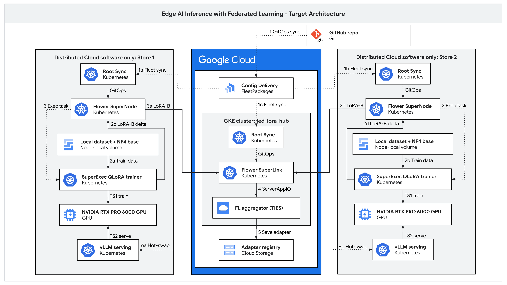

<!--
Copyright 2026 Google LLC

Licensed under the Apache License, Version 2.0 (the "License");
you may not use this file except in compliance with the License.
You may obtain a copy of the License at

    http://www.apache.org/licenses/LICENSE-2.0

Unless required by applicable law or agreed to in writing, software
distributed under the License is distributed on an "AS IS" BASIS,
WITHOUT WARRANTIES OR CONDITIONS OF ANY KIND, either express or implied.
See the License for the specific language governing permissions and
limitations under the License.
-->

# Federated Learning for Edge AI on Distributed Cloud software only reference architecture

## Overview

Multi-site enterprises such as retail chains generate valuable operational
signals at the edge, including point-of-sale logs, policy queries, and
store-floor multimodal events. Centralizing raw store data in the cloud to
fine-tune models violates data-residency rules, exposes sensitive records, and
saturates store wide-area network (WAN) links. Local retrieval-augmented
generation (Edge RAG) injects volatile catalog facts at query time, yet cannot
adapt model behavior, structured output syntax, or out-of-domain abstention
across locations.

This Solution Reference Architecture (SRA) defines a privacy-preserving
**federated Low-Rank Adaptation (Fed-LoRA)** architecture for fine-tuning open
models across edge stores for any modality, lab-proven on
`google/gemma-4-E2B-it` in two phases:

- **Phase A (pre-deployed baseline):** Existing Distributed Cloud software only
  store clusters, a central Google Kubernetes Engine (GKE) cluster, NVIDIA GPU
  Operator with time-slicing, fleet memberships, and model-serving
  prerequisites.
- **Phase B (federated learning layer):** A three-pod store split, a CPU-only
  Flower coordinator on GKE, subspace-preserving merging, a two-phase canary
  gate, and fleet observability on one GPU per store.

<!-- prettier-ignore -->
> [!IMPORTANT]
> **SRA versus SRI scope:** This document covers topology, VRAM sizing, security
> boundaries, and trade-offs. Phase A checks and Phase B platform deployment
> live in the [Solution Reference Implementation
> (SRI)](docs/reference-implementation.md); Flower app builds, runs, and Day-2
> operations live in the [Solution User Guide (SUG)](docs/user-guide.md).
> Cluster creation is out of scope; see [Distributed Cloud software only
> documentation](https://cloud.google.com/kubernetes-engine/distributed-cloud/bare-metal/docs)
> and [Open model serving on Distributed Cloud software
> only](https://docs.cloud.google.com/kubernetes-engine/distributed-cloud/bare-metal/docs/solutions/open-model-serving-sw-only).

<!-- prettier-ignore -->
> [!WARNING]
> **Disclaimer:** This is not an officially supported Google product. This
> project and solution guide are provided for architectural evaluation,
> reference, and educational purposes only, on a best-effort basis, with no
> official support and no service level agreement (SLA), and are not eligible
> for the [Google Open Source Software Vulnerability Rewards
> Program](https://bughunters.google.com/open-source-security). This solution
> does not include model weights: you must obtain any model you deploy yourself
> and comply with its upstream license (for example, the [Gemma Terms of
> Use](https://ai.google.dev/gemma/terms) before deploying Gemma 4 weights in
> your environment). Organizations planning a deployment must independently
> analyze, test, and validate all sizing, availability, security, and
> operational considerations against their specific production requirements.

### Features and capabilities

- **Sovereign in-store fine-tuning:** Retains raw store datasets locally while
  sending only compact LoRA-B adapter matrices (megabyte-scale payloads per
  round) outbound over gRPC.
- **Single-GPU serving and training:** Pairs NVIDIA GPU time-slicing (2 slices)
  with vLLM Level-1 sleep mode and quantized QLoRA fine-tuning on one store GPU.
- **Non-IID knowledge retention:** Preserves asymmetric store knowledge across
  non-IID sites via frozen-A LoRA (FFA-LoRA) and subspace-aware residual
  merging.
- **Two-phase canary consensus gate:** Quarantines merged candidate adapters
  until every participating store passes a local base-model judge check, then
  hot-swaps vLLM (< 100 ms lab-observed).
- **Two-track fleet delivery:** Decouples Config Delivery `FleetPackage`
  manifest rollouts from Python updates via ~258 KB Flower App Bundles (`.fab`).

### Architectural principles

- **Data sovereignty by construction:** Enforced by node-local
  `PersistentVolumeClaim` mounts and Flower gRPC payloads carrying only LoRA-B
  tensors and scalar metrics.
- **Keyless cloud identity:** Enforced by Fleet Workload Identity projected
  tokens exchanged via Security Token Service (STS) with zero static keys.
- **Outbound-only store networking:** Enforced by persistent SuperNode gRPC
  connections initiated from stores to a regional GKE internal `LoadBalancer`.
- **Fail-safe serving continuity:** Enforced by try/finally vLLM wake-up hooks,
  ephemeral trainer subprocess exit, and automatic canary rollback on failure.
- **Modality- and GPU-agnostic sizing:** Enforced by decoupling federation
  transport and PEFT lifecycle from model modality or hardcoded GPU SKUs.

---

## Architecture and design

The topology connects N single-node (or multi-node) Distributed Cloud software
only store clusters to one regional GKE aggregator cluster under a shared Google
Cloud Fleet.

### Components

**Edge store cluster (namespace `fed-lora-poc`, Phase B):**

- **`vllm-gemma4` (`Deployment`, `Service`):** vLLM server (port 8000) serving
  `google/gemma-4-E2B-it` with LoRA hot-swap and Level-1 sleep mode.
- **`flwr-supernode` (`Deployment`, `ClusterIP` `Service`):** CPU-only Flower
  daemon (`flwr/supernode:1.36.0`) holding outbound SuperLink connectivity and
  TCP port 9094 probes.
- **`flwr-trainer` (`Deployment`):** GPU SuperExec worker running
  process-isolated, ephemeral quantized QLoRA ClientApp subprocesses and
  exposing port 9100 metrics.
- **`shared-model-pvc` (`PersistentVolumeClaim`, `ConfigMap`):** Node-local 50
  GiB ReadWriteOnce volume at `/mnt/models` storing weights, store `train.jsonl`
  files, and adapters.
- **`ar-pull-refresher` (`CronJob`, `ConfigMap`):** 30-minute STS token rotator
  refreshing image pull secrets alongside Fleet Workload Identity
  external-account configs.

**Edge store cluster (Phase A baseline):**

- **Distributed Cloud software only cluster (1.36.0):** Customer-managed
  bare-metal store cluster registered globally to the Fleet with a `store`
  membership label.
- **NVIDIA GPU Operator (v26.7.0):** Runs open kernel driver 595.91.07, DCGM
  exporter (port 9400), and Phase A GPU time-slicing
  (`prerequisites/gpu-time-slicing/`, `ClusterPolicy`,
  `ConfigMap/time-slicing-config`) exposing two virtual GPU slices per card.
- **Config Sync and Managed Service for Prometheus:** Reconciles fleet manifests
  via `RootSync` and scrapes store `PodMonitoring` targets.

**Central Google Cloud hub (namespace `fed-lora-aggregator` and cloud
services):**

- **`flwr-superlink` (`Deployment`, internal `LoadBalancer` `Service`):**
  CPU-only coordinator (`flwr/superlink:1.36.0` base) exposing Fleet API (9092),
  Control/Exec API (9093), and metrics (9100).
- **Flower ServerApp (`apps/fed-lora` bundle):** Runs Round-0 zeroed seeding,
  subspace residual merging, and federation-wide canary consensus promotion.
- **Config Delivery (edge and central FleetPackages):** GitOps release service
  rolling out release-tag-pinned manifests from a private GitHub repository
  copy.
- **Cloud Storage, Artifact Registry, and Cloud Monitoring:** Stores round-0
  seeds plus candidate/promoted checkpoints, hosts images, and renders the
  4-quadrant dashboard.

### High-level architecture overview

### Federated learning workflow

The numbered callouts in the diagram trace one federated round:

1. **GitOps and bundle rollout (1, 1a–1c):** Config Delivery selects store
   variants by membership `store` label and syncs manifests via RootSync. Then
   `flwr run` submits the `.fab` bundle to SuperLink (9093) and seeds initial
   zeroed LoRA-B weights in < 1 ms.
2. **Sleep handoff and local QLoRA (2a–2d, 3):** SuperNode dispatches tasks
   (9094) to the trainer, spawning a ClientApp subprocess that triggers vLLM
   Level-1 sleep. It runs quantized frozen-A QLoRA with proximal and
   output-distribution anchoring on local `train.jsonl`, then wakes vLLM before
   exiting.
3. **Outbound adapter upload (3a–3b):** Each store sends updated LoRA-B tensors
   (megabyte-scale payloads) and scalar metrics outbound over gRPC to SuperLink
   (9092); raw store data stays local.
4. **Subspace-aware merge (4):** The ServerApp merges store LoRA-B deltas via
   frozen-A LoRA with sign-consistent pruning and SVD subspace residual
   projection, preserving asymmetric store knowledge without uniform-averaging
   dilution.
5. **Canary quarantine and consensus gate (5):** Merged weights stage in Cloud
   Storage under `checkpoints/candidate/round-N/`. Every store evaluates the
   candidate locally using the resident frozen base model in vLLM as a zero-VRAM
   judge; unanimous store consensus publishes to `checkpoints/promoted/` and
   `checkpoints/round-N/` (otherwise rollback retains the prior adapter).
6. **Live serving hot-swap (6a–6b):** Stores pull the promoted adapter onto
   `/mnt/models` and call `/v1/load_lora_adapter` on vLLM (8000) (< 100 ms
   lab-observed) with zero restarts. See
   [Example Flower app and algorithm parameters](docs/user-guide.md#example-flower-app-and-algorithm-parameters)
   in the SUG.

### Hardware constraints

NVIDIA GPU time-slicing exposes two virtual `nvidia.com/gpu` scheduling slices
per physical card so vLLM and the trainer bind concurrently without eviction,
yet **does not partition physical VRAM**. Single-GPU coexistence enforces
**mutually exclusive memory windows** via vLLM Level-1 sleep mode and ephemeral
ClientApp subprocess exit.

To size **any** candidate GPU with physical memory G (reserving a 1.5–2.0 GiB
driver margin M_safety), verify three equations:

- **Serving window (vLLM awake, trainer at 0 GiB VRAM):** Require (G × u_vllm) +
  V_cuda ≤ G − M_safety. Fraction u_vllm covers serving weights W_serve, runtime
  LoRA buffers V_lora, and activations V_act. Remaining KV cache is V_kv = (G ×
  u_vllm) − W_serve − V_lora − V_act.
- **Sleep handoff (host RAM for `/sleep?level=1`):** Require RAM_pod_limit ≥
  RAM_proc + W_serve and RAM_node_free ≥ W_serve. Level-1 sleep offloads W_serve
  to pinned host RAM (`cudaMallocHost`), drops KV pages, and leaves residual
  CUDA context V_sleep (~1.1–1.5 GiB).
- **Training window (vLLM asleep, QLoRA active):** Require V_sleep + W_quant +
  V_peft_opt + V_grad_act ≤ G − M_safety. Terms sum sleeping vLLM context
  V_sleep, quantized weights W_quant, LoRA-B and optimizer states V_peft_opt,
  and gradient activations V_grad_act.

Reference validation used **1× NVIDIA RTX PRO 6000 Blackwell (G = 96 GB GDDR7,
192 GiB host RAM)** per store (example settings:
[platform runtime](docs/reference-implementation.md#example-platform-runtime-parameters)
in SRI,
[Flower app](docs/user-guide.md#example-flower-app-and-algorithm-parameters) in
SUG):

<!-- mdformat off -->

| Operating window                                         | 96 GB RTX PRO 6000 capacity profile (lab-validated)                                                                                             | Peak GPU VRAM                | Host RAM constraint                                             |
| :------------------------------------------------------- | :---------------------------------------------------------------------------------------------------------------------------------------------- | :--------------------------- | :-------------------------------------------------------------- |
| **Serving window** (daytime inference)                   | ~81.6 GiB vLLM pool (~18 GiB BF16 serving weights + active LoRA adapter slot + >60 GiB KV cache) + ~2.1 GiB CUDA context; trainer idle at 0 GiB | ~83.7 GiB (~12.3 GiB free)   | `vllm-gemma4` pod memory limit exceeds `W_serve + RAM_proc`     |
| **Sleep handoff** (`/sleep?level=1`, < 1 s lab-observed) | KV cache freed; ~18 GiB serving weights copied to pinned host RAM, leaving residual CUDA context V_sleep                                        | ~1.1 GiB (~94.9 GiB free)    | Pod memory headroom prevents cgroup OOM during `cudaMallocHost` |
| **Training window** (quantized QLoRA)                    | ~1.1 GiB sleeping vLLM context + ~3.5 GiB quantized base weights + trainable LoRA-B, optimizer, and activation buffers                          | ~12–36 GiB (~60–84 GiB free) | Exits to 0 GiB VRAM before `/wake_up` (~0.8 s lab-observed)     |

<!-- mdformat on -->

<!-- prettier-ignore -->
> [!WARNING]
> Do not claim fit on untested GPUs. Before targeting smaller cards, compute
> V_kv, RAM_pod_limit, and training peak with the equations above for your model
> and workload profile, then test sleep/wake cycles under load.

---

## Supportability matrix (responsibilities)

<!-- mdformat off -->

| Component                                                      | Managed by                               | Notes                                                                                                 |
| :------------------------------------------------------------- | :--------------------------------------- | :---------------------------------------------------------------------------------------------------- |
| **Edge servers, GPUs, and store WAN**                          | Customer                                 | Bare-metal hosts, power, local disk (`/var/mnt/fed-lora-models`), and private routing to Google Cloud |
| **Distributed Cloud software only clusters (1.36.0)**          | Customer (Google-supported software)     | Customer manages OS and cluster lifecycle; Google supports platform binaries and Fleet agents         |
| **NVIDIA GPU Operator (v26.7.0, driver 595.91.07)**            | Customer                                 | Customer configures ClusterPolicy and time-slicing per GDC compatibility matrices                     |
| **GKE, Fleet Config Delivery, and Cloud Storage**              | Google                                   | Managed control planes, FleetPackage rollout pipeline, Workload Identity pools, and bucket storage    |
| **Fed-LoRA manifests and `apps/fed-lora` (reference package)** | Google (Solution — Apache-2.0 reference) | Reference assets in `GoogleCloudPlatform/gdc-solutions`; customer owns their private repository copy  |
| **Flower (flwr 1.36.0), vLLM, and PEFT libraries**             | Customer (open-source upstream)          | Apache-2.0 OSS frameworks built into customer Artifact Registry containers and app bundles            |
| **Foundation weights and store datasets**                      | Customer                                 | Customer accepts model terms (such as Gemma terms) and governs local data quality and privacy         |
| **Cloud Monitoring, Cloud Logging, and collectors**            | Joint                                    | Google operates Managed Service for Prometheus backends; customer manages dashboards and alerts       |

<!-- mdformat on -->

---

## Concepts and technologies

Canonical reference for service roles, ports, storage bindings, and delivery
tracks (platform parameters live in the
[SRI](docs/reference-implementation.md#example-platform-runtime-parameters)).

### Infrastructure and platform

- **GPU time-slicing (Phase A prerequisite):** `prerequisites/gpu-time-slicing/`
  applies `ConfigMap/time-slicing-config` and `ClusterPolicy/cluster-policy`
  outside store overlays (with `FleetPackage` detach-on-delete lifecycle) so
  each physical GPU advertises two virtual slices.
- **Node-local storage and co-location:**
  `PersistentVolumeClaim/shared-model-pvc` (50 GiB `ReadWriteOnce` at
  `/mnt/models`) is shared by vLLM and the non-root trainer. Co-location uses
  pod affinity, shared group permissions, and an expanded `/dev/shm` tmpfs.
- **Two-track fleet delivery:** Track 1 deploys manifests via
  `fed-lora-edge-package` (`fleet-package/fleetpackage-edge.yaml`) and
  `fed-lora-central-package` (`fleet-package/fleetpackage-central.yaml`),
  selecting store overlays via membership label `store` from
  `software-only/bare-metal/fed-lora/{apps/fed-lora/, base/, overlays/, prerequisites/, fleet-package/, scripts/, docker/, config/}`.
- **Bundle and GitHub pipeline:** Track 2 ships `apps/fed-lora` as a ~258 KB
  `.fab` archive via `flwr run` without container rebuilds; Track 1 reconciles
  GitHub-backed `FleetPackage` sources via a lab-validated Cloud Build 2nd-gen
  GitHub connection
  ([SRI](docs/reference-implementation.md#verify-cloud-build-repository-connection-registries-and-gemma-access)).

### Services and logic

- **vLLM serving (port 8000):** Runs `pytorch-vllm-serve:gemma4` on one GPU
  slice with dynamic runtime LoRA hot-swapping, Level-1 sleep/wake control, and
  bounded GPU memory reservation.
- **SuperNode (port 9094) and trainer (port 9100):** CPU-only SuperNode connects
  outbound to SuperLink 9092; GPU trainer runs process-isolated
  `flower-superexec` workers for quantized frozen-A QLoRA with base-model
  proximal anchoring.
- **SuperLink (ports 9092, 9093, 9100) and ServerApp:** CPU-only GKE service
  behind internal LoadBalancer `flwr-superlink-service` (ingress restricted to
  store egress CIDRs), coordinating subspace-aware LoRA merging and
  federation-wide canary consensus promotion.

### Observability and Google Cloud integration

- **Cluster telemetry:** Edge clusters configure the `addons.gke.io/v1alpha1`
  logging and monitoring resource in `kube-system` (detached on deletion) to
  enable application Managed Service for Prometheus scraping and Cloud Logging
  collection.
- **Prometheus and logs:** Four `PodMonitoring` resources scrape vLLM (8000),
  DCGM (9400), trainer (9100), and SuperLink (9100), feeding `fed_lora_*`
  OpenMetrics, JSON logs, and `config/monitoring/fed-lora-demo-dashboard.json`.

---

## Considerations

### Scalability and performance

- **Minimal WAN footprint:** Freezing a shared LoRA-A projection shrinks store
  uploads to megabyte-scale LoRA-B tensors per round rather than multi-gigabyte
  full model checkpoints.
- **Off-peak training windows:** Level-1 sleep pauses local serving for ~40 s
  per round (lab-observed) on single-GPU stores, so schedule rounds off-hours or
  stagger store cohorts.
- **CPU-only hub scaling:** Sub-millisecond Round-0 zero seeding and compact
  LoRA-B SVD merging let a CPU-only GKE Deployment coordinate multi-store
  cohorts.

### Resource management

- **Deterministic VRAM sawtooth:** Daytime vLLM reserves the majority of GPU
  memory for serving weights and KV cache, dropping to ~1.1 GiB during sleep
  before QLoRA allocates training tensors.
- **Pinned host RAM ceiling:** `vllm-gemma4` pod limits must exceed
  `RAM_proc + W_serve` (~18 GiB BF16) so `cudaMallocHost` offload avoids
  container OOM kills.
- **Zero idle trainer memory:** Subprocess isolation terminates the ClientApp
  process after every task, returning 100% of trainer VRAM before vLLM wakes.

### Availability and reliability

- **Guaranteed wake-up hooks:** Training and evaluation wrap sleep calls in
  try/finally blocks so `/wake_up` restores inference even on exceptions.
- **Quarantined promotion:** Degraded rounds stay isolated under
  `checkpoints/candidate/` while stores keep serving the promoted adapter
  uninterrupted.
- **In-memory SuperLink state:** SuperLink `state.db` is not persisted in the
  reference package; pod restarts reset active runs while preserving durable
  checkpoints and promoted adapters in Cloud Storage.

### Operational complexity

- **Regional versus global memberships:** GKE aggregator memberships are
  regional whereas store memberships are global; fleet commands must pass
  matching locations.
- **Config Sync CLI false negative:** `config-management status` can report
  `NOT_INSTALLED` while RootSync objects are `SYNCED`; verify RootSync resources
  directly.
- **Model-specific PEFT compatibility:** Hybrid-attention or multimodal models
  such as Gemma 4 require scoping LoRA to compatible linear layers and
  preserving KV-sharing cache semantics. See
  [Build container images with Cloud Build](docs/reference-implementation.md#build-container-images-with-cloud-build)
  in the SRI.
- **Shared registry safety:** Never delete a shared Artifact Registry repository
  during teardown if other packages consume it.

### Security and compliance

- **Data-egress boundary:** Raw `train.jsonl` records and customer prompts never
  leave `shared-model-pvc`; only compact LoRA-B adapter tensors and scalar
  metrics leave the store.
- **Keyless identity and outbound networking:** Pods exchange projected Workload
  Identity tokens (`svc.id.goog`) with zero JSON keys. Stores connect outbound
  on TCP 9092 to internal GKE LoadBalancer `flwr-superlink-service`, restricted
  to store egress CIDRs to avoid `0.0.0.0/0` firewall purges.
- **Control-endpoint restriction:** vLLM development control endpoints exposing
  unauthenticated sleep and runtime adapter routes on port 8000 must stay
  ClusterIP-internal or ingress-restricted in production.
- **Production hardening backlog:** Kubernetes network policies, Flower gRPC
  mTLS, SuperNode auth (plaintext in the reference package), SecAgg+, and
  differential privacy are unimplemented. Add these controls before production
  exposure.

---

## Design decisions

### Federated framework: Flower versus NVIDIA FLARE and TensorFlow Federated

- **Selected option:** Open-source Flower (1.36.0, Apache-2.0) with decoupled
  SuperLink, SuperNode, and process-isolated SuperExec workers plus `.fab`
  bundles.
- **Rationale:** Native PyTorch/PEFT/QLoRA integration, clean split between
  persistent CPU daemons and ephemeral GPU subprocesses, and ~258 KB bundle
  rollouts without rebuilding ~10–11 GB CUDA images (lab-measured).
- **Alternatives rejected:** NVIDIA FLARE adds heavier provisioning ceremony for
  edge bundle iteration; TensorFlow Federated targets TensorFlow/JAX rather than
  PyTorch + PEFT + vLLM.

### Single-GPU sharing: GPU time-slicing with vLLM sleep mode versus MIG and in-process serving

- **Selected option:** NVIDIA GPU Operator time-slicing (2 slices) paired with
  vLLM Level-1 sleep mode and subprocess-isolated quantized QLoRA.
- **Rationale:** Portable across edge GPUs, reserving most GPU VRAM for daytime
  serving and KV cache. Level-1 sleep releases active weights and KV pages in <
  1 s (lab-observed) without pod restarts or a second GPU.
- **Alternatives rejected:** Multi-Instance GPU (MIG) is unavailable on many
  edge GPUs (for example L4 and RTX Ada workstation cards) and statically
  fragments VRAM; static low vLLM memory caps starve KV cache; in-process
  training couples failure domains.

### Non-IID aggregation: frozen-A LoRA with subspace-aware merging and canary gating versus plain FedAvg

- **Selected option:** Frozen-A LoRA (FFA-LoRA) with subspace-aware residual
  merging, proximal base-model anchoring, and a store canary consensus gate.
- **Rationale:** Plain FedAvg over both LoRA matrices introduces bilinear
  cross-term noise and dilutes site-specific knowledge by 1/N across N stores;
  freezing LoRA-A and projecting orthogonal subspace residuals preserves
  asymmetric store policies behind unanimous canary validation.
- **Alternatives rejected:** Plain FedAvg diluted asymmetric store policies
  across rounds; unanchored local fine-tuning drifted on general queries and
  out-of-domain abstention.

### Package delivery: Config Delivery FleetPackages plus Flower app bundles versus single-track GitOps

- **Selected option:** Two-track delivery pairing Config Delivery `FleetPackage`
  manifests (variant-selected by membership label `store`) for infrastructure
  with `flwr run` bundles for Python logic.
- **Rationale:** Slow-changing Kubernetes resources gain tag-pinned fleet
  rollouts and rollbacks, while hyperparameter and strategy updates ship in
  seconds without image pulls.
- **Alternatives rejected:** Single-track GitOps baking Python into CUDA images
  forces multi-gigabyte rebuilds per experiment; imperative `kubectl` scripting
  drifts across stores.

### Store-to-cloud networking: outbound-only gRPC to an internal load balancer versus inbound store endpoints

- **Selected option:** Outbound gRPC initiated from store SuperNodes to a
  regional GKE internal LoadBalancer (port 9092) restricted to store egress
  CIDRs.
- **Rationale:** Stores sit behind NAT and strict firewalls blocking inbound
  traffic; outbound gRPC traverses private VPN/Interconnect links with zero
  inbound store ports.
- **Alternatives rejected:** Hub-to-store push requires per-store inbound
  firewall pinholes; public SuperLink IPs widen internet exposure.

### Quality gating: edge-local base-model judge versus cloud LLM judges and regex checks

- **Selected option:** Edge-local canary evaluation using the frozen
  `google/gemma-4-E2B-it` base model resident in vLLM (with the candidate
  adapter disabled for judging) and unanimous federation consensus.
- **Rationale:** Uses 0 MB extra VRAM, keeps evaluation data in-store, catches
  numeric fabrications and abstention regressions missed by regexes, and avoids
  cloud judge latency or cost.
- **Alternatives rejected:** Cloud LLM judges add external dependencies and
  egress; regex checks missed paraphrases and subtle hallucinations in lab
  audits.

---

## Assumptions and limitations

### Assumptions

- **Pre-deployed Phase A clusters:** Distributed Cloud software only 1.36.0
  store clusters and a regional GKE 1.35+ cluster are registered to the Fleet
  with NVIDIA GPU Operator v26.7.0 (driver 595.91.07).
- **Private repository copy:** Operators maintain a **private** clone or copy of
  `GoogleCloudPlatform/gdc-solutions` (`software-only/bare-metal/fed-lora/`),
  not a public fork.
- **Private WAN and model access:** Stores have private IP routing (VPN or
  Interconnect) to the GKE internal LoadBalancer (9092), HTTPS egress to Google
  Cloud APIs, and accepted Gemma terms.

### Limitations

- **Validated GPU SKU:** Lab testing covered 1× NVIDIA RTX PRO 6000 Blackwell
  (96 GB) per store; size other GPUs with the
  [Hardware constraints](#hardware-constraints) equations before rollout.
- **Brief serving pause:** Single-GPU stores pause serving for ~40 s per round
  (lab-observed) during Level-1 sleep training.
- **PoC security gaps:** Network policies, Flower gRPC mTLS/auth, SecAgg+, and
  differential privacy are unset in the reference package. Restrict network
  access to vLLM sleep and adapter control routes on port 8000.
- **Ephemeral SuperLink state:** In-memory `state.db` resets active runs on
  SuperLink restart, though Cloud Storage checkpoints and promoted adapters
  persist.
- **Gemma 4 adapter scope:** The reference implementation scopes LoRA adaptation
  to compatible text linear layers and applies a container startup LoRA
  compatibility hook (see the [SRI](docs/reference-implementation.md)).

---

## What's next

- Verify Phase A prerequisites and deploy the platform in the
  [Solution Reference Implementation (SRI)](docs/reference-implementation.md).
- Build the Flower app, run federated rounds, monitor telemetry, and manage
  upgrades or rollbacks in the [Solution User Guide (SUG)](docs/user-guide.md).
- Review
  [Open model serving on Distributed Cloud software only](https://docs.cloud.google.com/kubernetes-engine/distributed-cloud/bare-metal/docs/solutions/open-model-serving-sw-only)
  and [Flower documentation](https://flower.ai/docs/framework/).
