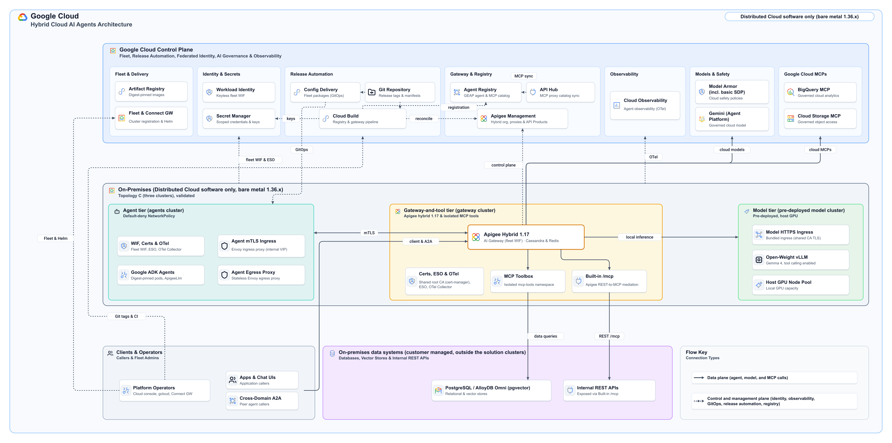
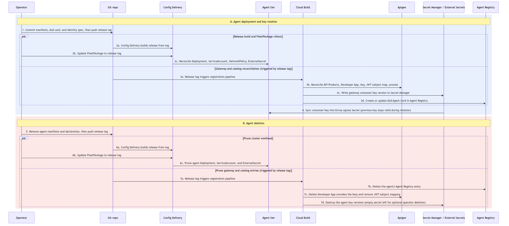
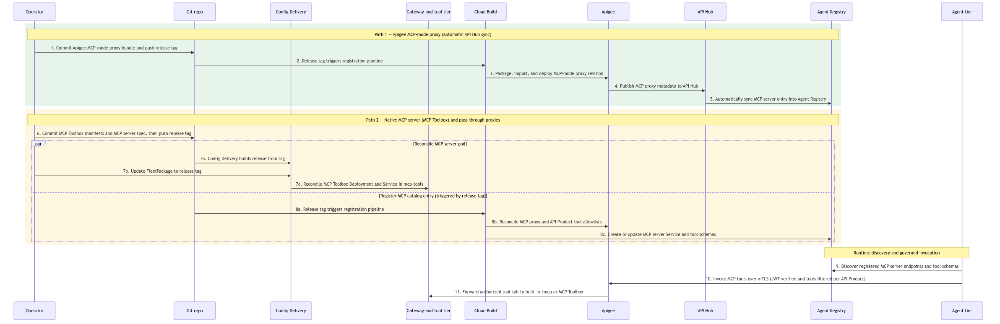
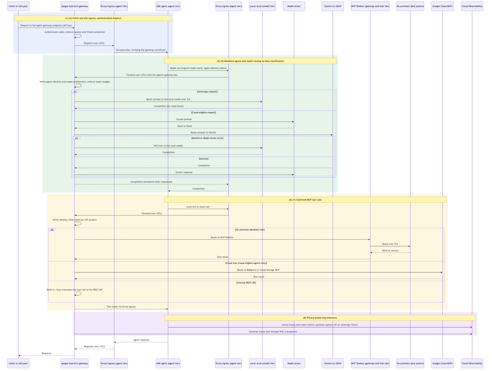

<!--
Copyright 2026 Google LLC

Licensed under the Apache License, Version 2.0 (the "License");
you may not use this file except in compliance with the License.
You may obtain a copy of the License at

    http://www.apache.org/licenses/LICENSE-2.0

Unless required by applicable law or agreed to in writing, software
distributed under the License is distributed on an "AS IS" BASIS,
WITHOUT WARRANTIES OR CONDITIONS OF ANY KIND, either express or implied.
See the License for the specific language governing permissions and
limitations under the License.
-->

# Hybrid Cloud AI Agents on Distributed Cloud software only reference architecture

## Overview

This Solution Reference Architecture (SRA) defines a solution for running AI
agents on-premises on
[Distributed Cloud software only](https://docs.cloud.google.com/kubernetes-engine/distributed-cloud/bare-metal/docs)
bare-metal clusters. Google Cloud governs these agents through the
[Apigee hybrid 1.17](https://docs.cloud.google.com/apigee/docs/hybrid/v1.17/what-is-hybrid)
AI gateway and Gemini Enterprise Agent Platform (GEAP) capabilities. Those
capabilities include
[Agent Registry](https://docs.cloud.google.com/agent-registry/overview) for
agent and
[Model Context Protocol (MCP)](https://modelcontextprotocol.io/specification/2025-03-26)
server discovery,
[agent observability in Cloud Observability](https://docs.cloud.google.com/stackdriver/docs/instrumentation/agent-observability),
and [Model Armor](https://docs.cloud.google.com/model-armor/overview) safety
policies. Each agent runs under its own federated workload identity, and a
release pipeline registers it in Agent Registry automatically on every release.
Together, the on-premises agent runtime on Distributed Cloud software only and
the management plane served from a Google Cloud region form the Hybrid Cloud AI
Agents solution.

Enterprises need to manage agent identity, registration, governance, and
observability in a centralized manner without exposing sovereign data. This
stack pairs
[Google Agent Development Kit (ADK)](https://google.github.io/adk-docs/) agents
with the Apigee hybrid 1.17 AI gateway and isolated
[MCP Toolbox for Databases](https://github.com/googleapis/genai-toolbox). Agents
call models through the first-party ADK ApigeeLlm model connector. Through one
governed gateway, agents can use both a local open-weight model (for example,
Gemma on a pre-deployed vLLM cluster) and
[Gemini on Gemini Enterprise Agent Platform](https://docs.cloud.google.com/vertex-ai/generative-ai/docs/overview).
The gateway routes requests by data classification with Model Armor screening,
token quotas, and local failover.

This solution is meant to be a proof of concept (MVP). It demonstrates the
feasibility of a hybrid cloud agentic platform on Distributed Cloud software
only. It provides test configurations for functional validation, not
production-ready configurations of every component. For production-grade
configurations, especially security, the customer would still need to work with
Google sales and support specialists for products outside Distributed Cloud
software only, such as Gemini Enterprise Agent Platform, Apigee hybrid, and
Model Armor. For open-source components, community support would be required.

<!-- prettier-ignore -->
> [!IMPORTANT]
> Deploying or upgrading the model cluster is out of scope; see [Open model
> serving on Distributed Cloud software
> only](https://docs.cloud.google.com/kubernetes-engine/distributed-cloud/bare-metal/docs/solutions/open-model-serving-sw-only)
> for an example of how to deploy and serve an open model on Distributed Cloud
> software only using vLLM.

<!-- prettier-ignore -->
> [!IMPORTANT]
> SRA versus SRI versus SUG scope. This document covers architecture and design
> decisions; see the [SRI](docs/reference-implementation.md) for deployment and
> the [SUG](docs/user-guide.md) for Day-2 operation and verification steps.

<!-- prettier-ignore -->
> [!WARNING]
> This solution validates functional behavior only; HA, DR, multi-GPU
> redundancy, and benchmarks are out of scope.

<!-- prettier-ignore -->
> [!WARNING]
> **Disclaimer:** This is not an officially supported Google product. This
> project and solution guide are provided for architectural evaluation,
> reference, and educational purposes only, on a best-effort basis, with no
> official support and no service level agreement (SLA), and are not eligible
> for the [Google Open Source Software Vulnerability Rewards
> Program](https://bughunters.google.com/open-source-security). This solution
> does not include model weights: you must obtain any model you deploy yourself
> and comply with its upstream license (for example, the [Apache License
> 2.0](https://ai.google.dev/gemma/docs/gemma_4_license) for Gemma 4 weights).
> Organizations planning a deployment must independently analyze, test, and
> validate all sizing, availability, security, and operational considerations
> against their specific production requirements.

### Features and capabilities

- **Hybrid model access:** Sovereign prompts stay on local vLLM with zero cloud
  bytes; cloud-eligible prompts route to Gemini on GEAP via
  [Model Armor](https://docs.cloud.google.com/model-armor/overview) with local
  failover if needed. Once a turn or session consumes sovereign data from a
  sovereign agent or `mcp-toolbox`, sticky downgrade keeps later model calls on
  local vLLM and blocks cloud MCP tools.
- **Centralized gateway policy control:** The Apigee hybrid AI gateway governs
  all agent ingress, [Agent2Agent (A2A)](https://a2a-protocol.org/latest/)
  calls, and egress so no agent bypasses policy enforcement.
- **Automated agent and MCP catalog:** A Git-tag
  [Cloud Build](https://docs.cloud.google.com/build/docs/overview) pipeline
  reconciles agents and native MCP servers in
  [GEAP Agent Registry](https://docs.cloud.google.com/agent-registry/overview)
  via
  [manual registration](https://docs.cloud.google.com/agent-registry/manual-registration).
  Apigee MCP-mode proxies sync automatically via
  [API Hub](https://docs.cloud.google.com/apigee/docs/apihub/what-is-api-hub).
- **Unified MCP mediation:** Pairs Apigee's
  [built-in MCP server](https://docs.cloud.google.com/apigee/docs/api-platform/apigee-mcp/enable-mcp),
  [BigQuery MCP](https://docs.cloud.google.com/bigquery/docs/use-bigquery-mcp),
  and
  [Cloud Storage MCP](https://docs.cloud.google.com/storage/docs/use-cloud-storage-mcp)
  with [MCP Toolbox for Databases](https://github.com/googleapis/genai-toolbox),
  filtering tools per API Product.
- **Per-agent keyless identity:** Each agent uses a
  [fleet Workload Identity Federation (fleet WIF)](https://docs.cloud.google.com/agent-registry/identity-and-identifiers)
  principal verified at Apigee against the agent cluster's JSON Web Key Set
  (JWKS). Apigee authenticates with
  [Apigee WIF](https://docs.cloud.google.com/apigee/docs/hybrid/v1.17/enable-workload-identity-federation).
- **Privacy-preserving observability:** OpenTelemetry exports GenAI traces and
  token metrics to
  [agent observability in Cloud Observability](https://docs.cloud.google.com/stackdriver/docs/instrumentation/agent-observability)
  with prompt capture disabled on sovereign flows.

### Architectural principles

- **Single policy enforcement point:** All client, A2A, model, and MCP calls
  traverse Apigee hybrid; eBPF `NetworkPolicy` and Envoy proxies block direct
  pod egress.
- **One consistent identity per agent:** Each agent uses one Kubernetes service
  account and fleet WIF principal across Apigee API Products, JWT verification,
  and Agent Registry.
- **Git-tag delivery and catalog automation:** Pushing a Git release tag
  triggers Cloud Build reconciliation for Apigee and Agent Registry. The same
  tag builds a
  [Config Delivery](https://docs.cloud.google.com/kubernetes-engine/config-sync/docs/concepts/fleet-packages)
  release that rolls out when the `FleetPackage` is updated to that tag. API Hub
  syncs MCP-mode proxies automatically.
- **Sovereignty by data classification:** Sovereign traffic stays on the local
  model with prompt capture disabled and cloud tools stripped; cloud-eligible
  traffic passes through Model Armor.
- **Standard interfaces between replaceable layers:** This reference
  implementation uses Google ADK, Apigee hybrid, Fleet management, Config
  Delivery, Agent Registry, Model Armor, and Cloud Observability. Agents,
  gateway, models, and tools interact over A2A, MCP, OpenAI-compatible model
  APIs, and OpenTelemetry, so open-source or partner components such as
  [kagent](https://kagent.dev/) or [agentgateway](https://agentgateway.dev/) can
  be evaluated for each layer.

## Architecture and design

### Components

- **Agent tier:**
  - **Google ADK agents:** Digest-pinned `Deployment` workloads in
    `agent-workloads` (the dedicated namespace isolating agent pods) using the
    first-party ADK ApigeeLlm model connector.
  - **Agent mTLS ingress proxy:** Redundant Envoy proxy terminating Apigee mTLS
    and forwarding verified requests to agent pods.
  - **Agent egress proxy:** Redundant Envoy proxy attaching the agent's gateway
    credential and forwarding egress over mTLS to Apigee.
  - **Network isolation policies:** Default-deny `NetworkPolicy` enforced by
    Dataplane V2 restricting agent pods to Envoy, DNS, and OpenTelemetry.
- **Gateway-and-tool tier:**
  - **Apigee hybrid 1.17 runtime:** Central AI and API gateway hosting ingress,
    policy enforcement, Cassandra quotas, and the built-in `/mcp` server.
  - **MCP Toolbox for Databases:** Google open-source MCP server in `mcp-tools`
    exposing governed SQL and vector-search tools.
- **Shared platform services (agent and gateway-and-tool tiers):**
  - **Certificate and secret operators:** System-managed `cert-manager` issues
    internal TLS/mTLS certificates from a shared root CA.
    [External Secrets Operator (ESO)](https://external-secrets.io/latest/) uses
    namespace-scoped `SecretStore` resources and per-namespace fleet WIF
    principals to sync gateway keys, database credentials, and the public CA
    bundle from Secret Manager.
  - **Telemetry collectors:**
    [Google-Built OpenTelemetry Collector](https://docs.cloud.google.com/stackdriver/docs/instrumentation/google-built-otel),
    Managed Service for Prometheus collectors, and cluster log forwarders.
- **Model tier (pre-deployed prerequisite):**
  - **Model-tier HTTPS ingress:** Bundled cluster ingress presenting a shared
    internal CA certificate for Apigee TLS verification.
  - **Pre-deployed vLLM server:** GPU-backed open-weight model server (for
    example, Gemma 4) deployed per the companion guide. Gemma 4
    (`google/gemma-4-31B-it`) is released under the
    [Apache License 2.0](https://ai.google.dev/gemma/docs/gemma_4_license), and
    the weights are not gated.
- **On-premises data systems (validation data sources, customer managed):**
  - **Databases, vector stores, and APIs:** Customer-managed PostgreSQL, AlloyDB
    Omni with `pgvector`, search stores, and internal REST APIs. They run
    outside the solution clusters as validation data sources for end-to-end tool
    calling and grounding flows. Lab verification used synthetic PostgreSQL with
    `pgvector` on a separate Distributed Cloud software only test cluster
    outside the solution clusters.
- **Google Cloud control plane:**
  - **Fleet, GitOps, and release automation:** GKE Hub Fleet, Connect Gateway,
    fleet WIF,
    [Config Delivery](https://docs.cloud.google.com/kubernetes-engine/config-sync/docs/concepts/fleet-packages),
    and [Cloud Build](https://docs.cloud.google.com/build/docs/overview). Cloud
    Build reconciles Apigee identities, API Products, proxies, and Agent
    Registry entries on Git release tags.
  - **Governance, discovery, and observability:** Apigee control plane,
    [API Hub](https://docs.cloud.google.com/apigee/docs/apihub/what-is-api-hub),
    GEAP Agent Registry, Gemini on GEAP, Model Armor, Secret Manager, and Cloud
    Observability.

### Supported deployment topologies

All clusters register in one
[Google Cloud Fleet](https://docs.cloud.google.com/kubernetes-engine/fleet-management/docs/overview)
and share one fleet workload identity pool across three topologies:

- **Topology A (1 cluster):** Co-locates the `agent tier`,
  `gateway-and-tool tier`, and `model tier` on one cluster using namespace and
  node-pool isolation.
- **Topology B (2 clusters):** Co-locates the `agent tier` and
  `gateway-and-tool tier` on one cluster and isolates the pre-deployed GPU
  `model tier` on a second cluster.
- **Topology C (3 clusters, validated; see Lab verification):** Dedicates
  separate clusters to the `agent tier`, `gateway-and-tool tier`, and
  pre-deployed `model tier` for blast-radius and RBAC isolation.

### High-level architecture

The following block diagram shows the validated `Topology C`. It illustrates the
agent tier, the gateway-and-tool tier, and the pre-deployed model tier in one
fleet. It also shows the Google Cloud control plane services that govern them,
plus the clients, operators, and on-premises data systems they connect to. Lines
show which functional blocks interconnect; the runtime data flows are described
in
[Agent runtime, MCP, and control-plane flows](#agent-runtime-mcp-and-control-plane-flows).

### Agent and MCP server deployment flow

Operators deploy, update, or remove agents and MCP servers through a release-tag
Git workflow before runtime traffic occurs.

#### Agent deployment, key rotation, and deletion

1. **Tag release:** Operator commits the agent's Kubernetes manifests, A2A card,
   and identity spec (`agent.yaml`), then pushes a Git release tag.
2. **Build release and roll out workload:** Config Delivery builds a release
   from the tagged Git path. The operator then updates the `FleetPackage` to
   that release tag, reconciling the agent's `Deployment`, `ServiceAccount`,
   `NetworkPolicy`, and `ExternalSecret` on the agent tier.
3. **Reconcile gateway and catalog:** Pushing the same Git release tag
   automatically triggers Cloud Build. The pipeline reconciles Apigee API
   Products, the Developer App, consumer key, JWT subject map, proxy bundles,
   Secret Manager key version, and GEAP Agent Registry card.
4. **Sync and rotate keys:** External Secrets syncs the key into the Envoy
   egress `Secret`. Bumping the key version in Git and tagging a release rotates
   keys via the pipeline, Secret Manager, and External Secrets. The previous key
   stays valid until the new one is in place, and the Envoy egress proxy reloads
   the new key without restarting.
5. **Delete an agent:** Removing an agent in Git, pushing a release tag, and
   updating the `FleetPackage` to that tag prunes the cluster workload via
   Config Delivery. The tag-triggered Cloud Build pipeline deletes the Agent
   Registry entry, the Apigee Developer App (revoking the agent's key), and the
   JWT map. It then destroys the agent's key versions in Secret Manager, leaving
   only the empty secret for optional operator deletion.

#### MCP server deployment and registration

1. **Path 1 (Apigee MCP-mode proxy):** Pushing a release tag for an Apigee
   MCP-mode proxy bundle triggers Cloud Build to deploy the proxy revision;
   Apigee publishes metadata to API Hub, which automatically syncs the MCP
   server into GEAP Agent Registry.
2. **Path 2 (Native and pass-through MCP servers):** This path covers MCP
   Toolbox and proxied cloud MCP servers. Pushing a release tag triggers Cloud
   Build to register the MCP server and tools in GEAP Agent Registry. The same
   tag builds the Config Delivery release, and updating the `FleetPackage` to
   that tag reconciles MCP Toolbox in `mcp-tools`.
3. **Discovery and governed calls:** Agents discover MCP endpoints in Agent
   Registry and send all `tools/list` and `tools/call` requests through Apigee
   for JWT verification and API Product tool filtering.

### Agent runtime, MCP, and control-plane flows

The following sequence diagram shows the end-to-end runtime paths between
callers, the agent tier, the Apigee hybrid AI gateway, the models, the MCP
servers, and Cloud Observability; the numbered steps below match the diagram.

1. **Client and A2A ingress (1):** Callers and peer agents send requests to the
   Apigee hybrid HTTPS ingress; the agent tier exposes no caller-facing
   endpoints. Northbound caller dispatch proxies use a dedicated
   `northbound-agent-callers` API Product, separate from internal agent egress
   products.
2. **Authenticated agent dispatch (2):** Apigee authenticates the caller,
   enforces quotas, and forwards the request over mTLS to the agent-tier Envoy
   ingress proxy. The proxy verifies the gateway certificate before routing to
   the ADK agent pod.
3. **Mediated agent egress (3):** Default-deny `NetworkPolicy` forces all agent
   egress through the local Envoy egress proxy. The ADK client attaches the
   projected KSA JWT in `x-agent-ksa-token`, and Envoy injects the agent's
   `x-api-key` over mTLS to Apigee.
4. **Sovereign local inference (4):** For sovereign requests and cloud-eligible
   failover traffic, Apigee verifies agent identity and model entitlement. It
   then enforces token budgets and routes the prompt over TLS to the
   pre-deployed vLLM model tier.
5. **Governed cloud model routing (5):** For cloud-eligible requests to Gemini
   on GEAP, Apigee screens prompts and responses through Model Armor and
   enforces token quotas. On service errors, it fails over automatically to
   local vLLM.
6. **Apigee built-in MCP and Google Cloud MCPs (6a, 6b):** Apigee proxies
   authorized cloud tool calls (6a) to BigQuery MCP and Cloud Storage MCP. It
   translates REST APIs into MCP tools via its built-in `/mcp` server (6b) and
   strips cloud tools for sovereign agents.
7. **On-premises MCP Toolbox (7a, 7b):** Apigee verifies per-tool entitlements
   and routes local tool calls (7a) to MCP Toolbox in `mcp-tools`. MCP Toolbox
   queries on-premises databases over TLS (7b) using credentials synced by
   External Secrets.
8. **Privacy-preserving telemetry (8):** Agents, Envoy proxies, and collectors
   export OpenTelemetry traces, Prometheus metrics, and logs to Cloud
   Observability with prompt capture disabled on sovereign flows.
9. **Control-plane and delivery lanes:** Operators manage External Secrets
   Operator and Apigee via the Connect Gateway Helm pipeline, using
   system-managed `cert-manager`. Config Delivery builds releases from Git tags
   and reconciles `FleetPackage` manifests when updated to those tags. Fleet WIF
   and External Secrets manage authentication and secrets, while Cloud Build
   reconciles Apigee and Agent Registry.

### Hardware constraints

Bare-metal compute, storage, and GPU prerequisites:

<!-- mdformat off -->

| Tier                       | Minimum Node / Pool Profile                                                                                                                                                                                                                                                                                                                                 | Storage, Network, and Memory Constraints                                                                                             |
| :------------------------- | :---------------------------------------------------------------------------------------------------------------------------------------------------------------------------------------------------------------------------------------------------------------------------------------------------------------------------------------------------------- | :----------------------------------------------------------------------------------------------------------------------------------- |
| **Agent tier**             | [Node prerequisites](https://docs.cloud.google.com/kubernetes-engine/distributed-cloud/bare-metal/docs/installing/node-machine-prerequisites#resource-requirements-for-all-cluster-types-using-the-default-profile) (default profile): 4 minimum / 8 recommended x86-64-v3+ CPUs or vCPUs, 16 GiB minimum / 32 GiB recommended RAM, plus workload headroom. | 128 GiB minimum / 256 GiB recommended SSD; host NICs only.                                                                           |
| **Gateway and tool tier**  | [Apigee 1.17 minimums](https://docs.cloud.google.com/apigee/docs/hybrid/v1.17/cluster-overview): `apigee-data` and `apigee-runtime` pools, 1 node per zone (3 per region), 4 CPU / 16 GiB RAM non-production (8 CPU / 32 GiB production), plus MCP headroom.                                                                                                | Dedicated SAN or direct SSD (no NFS), >= 1 Gbps NIC, low-latency Cassandra storage with synchronized clocks, and LoadBalancer VIPs.  |
| **Model tier (reference)** | Pre-deployed per [Open model serving on Distributed Cloud software only](https://docs.cloud.google.com/kubernetes-engine/distributed-cloud/bare-metal/docs/solutions/open-model-serving-sw-only#hardware-constraints).                                                                                                                                      | Sized per the open model serving guide (Gemma 4 31B on one 96 GB NVIDIA RTX PRO 6000 GPU, 100 Gi node-local PVC, 16 GiB `/dev/shm`). |

<!-- mdformat on -->

### Lab verification

- **Validated three-cluster topology:** Validated `Topology C` in one fleet.
  Dedicated `agent tier` and `gateway-and-tool tier` clusters run on Distributed
  Cloud software only `1.36.200-gke.118` bare metal. The pre-deployed
  `model tier` cluster serves `google/gemma-4-31B-it` on vLLM on one 96 GB
  NVIDIA RTX PRO 6000 GPU.
- **Keyless gateway authentication and catalog automation:** Validated Apigee
  hybrid `1.17.3` keyless authentication via fleet WIF with zero static
  service-account keys. Release-tag Cloud Build reconciliation and
  `FleetPackage` rollouts handled agent deployment, GEAP Agent Registry
  registration, key rotation without restarting the egress proxies, and agent
  deletion. Apigee MCP-mode proxies synced automatically through API Hub.
- **Functional verification scope:** Verified local `google/gemma-4-31B-it`
  sovereignty with zero cloud bytes, plus Model Armor on cloud model routing to
  `google/gemini-3.5-flash` (Gemini 3.5 Flash) on GEAP with local failover. Also
  verified API Product MCP tool filtering across all four MCP servers,
  zero-bypass Envoy egress, and A2A calls through Apigee. Verification covered
  model aliases with per-model access control, SSE streaming, HTTP 429 token
  quotas, and Cloud Observability export; see the
  [SRI](docs/reference-implementation.md) and [SUG](docs/user-guide.md).

## Supportability matrix (responsibilities)

The following table lists who manages each solution component:

<!-- mdformat off -->

| Component                                                                                      | Managed by   | Notes                                                                                                                                                                                                                                                                               |
| :--------------------------------------------------------------------------------------------- | :----------- | :---------------------------------------------------------------------------------------------------------------------------------------------------------------------------------------------------------------------------------------------------------------------------------- |
| **Hosts, OS, storage, NTP, and VIPs**                                                          | **Customer** | Provisions bare-metal servers, storage, networking etc.                                                                                                                                                                                                                             |
| **Pre-deployed vLLM, GPU Operator, and model-tier ingress**                                    | **Joint**    | Google documents the reference deployment in [Open model serving on Distributed Cloud software only](https://docs.cloud.google.com/kubernetes-engine/distributed-cloud/bare-metal/docs/solutions/open-model-serving-sw-only); customer operates the model cluster and GPU Operator. |
| **Distributed Cloud software only (1.36.x+) and Config Sync**                                  | **Joint**    | Google supports the platform under SLA; customer installs clusters in Step 0, runs the Config Delivery pipeline or documented Helm charts, and manages upgrades.                                                                                                                    |
| **Apigee hybrid 1.17 runtime and control plane**                                               | **Joint**    | Google operates the control plane and supports Apigee hybrid 1.17 on certified bare-metal versions; customer operates the runtime Helm release and Cassandra data lifecycle.                                                                                                        |
| **Config Delivery, Cloud Build, fleet WIF, Gemini on GEAP, Model Armor, and Cloud MCPs**       | **Joint**    | Google operates the cloud services; customer configures IAM, API Products, triggers, and safety templates.                                                                                                                                                                          |
| **Agent observability in Cloud Observability, API Hub, and GEAP Agent Registry**               | **Joint**    | Google operates the cloud backends; customer configures OpenTelemetry Collectors and the registration pipeline.                                                                                                                                                                     |
| **Google ADK agents, MCP Toolbox, Envoy proxies, and External Secrets Operator**               | **Joint**    | Google provides deployment documentation and reference manifests as part of this solution; customer pins images and operates the workloads.                                                                                                                                         |
| **Production sizing, HA, and security for components outside Distributed Cloud software only** | **Customer** | Production-grade sizing, high availability, and security configuration of all components outside Distributed Cloud software only, including open-source components. Engage Google sales and support for Google products such as Apigee hybrid and Model Armor.                      |

<!-- mdformat on -->

## Concepts and technologies

### Infrastructure and platform

- **Bare-metal eBPF network isolation:** Distributed Cloud software only
  `1.36.x` runs Dataplane V2, enforcing Kubernetes `NetworkPolicy` at the kernel
  eBPF layer to isolate `agent-workloads` and `mcp-tools`.
- **Step 0 provisioning plus GitOps and Helm delivery:** Operators bootstrap
  clusters in **Step 0**. They then manage External Secrets Operator and Apigee
  hybrid via one Connect Gateway Helm pipeline using system-managed
  `cert-manager`.
  [Config Delivery Fleet packages](https://docs.cloud.google.com/kubernetes-engine/config-sync/docs/concepts/fleet-packages)
  reconcile the remaining manifests.
- **Keyless workload identity and JWKS verification:** Pods authenticate with
  short-lived tokens from
  [fleet Workload Identity Federation](https://docs.cloud.google.com/kubernetes-engine/distributed-cloud/bare-metal/docs/how-to/use-fleet-workload-identity).
  Each cluster publishes a **JSON Web Key Set (JWKS)** for Apigee cross-cluster
  verification. The JWKS contains the public keys used to verify service-account
  token signatures
  ([Workload Identity Federation with Kubernetes](https://docs.cloud.google.com/iam/docs/workload-identity-federation-with-kubernetes)).

### Services and logic

- **Hardened ADK agents and Agent Registry catalog:**
  [Google ADK](https://google.github.io/adk-docs/) agents run as immutable
  containers in `agent-workloads` and call models via the first-party ADK
  ApigeeLlm model connector. Cloud Build publishes their
  [A2A Agent Cards](https://docs.cloud.google.com/agent-registry/register-agents)
  and MCP bindings to GEAP Agent Registry.
- **Envoy ingress and egress proxies:** Envoy ingress terminates Apigee mTLS and
  verifies its client certificate because cross-cluster
  [SNAT](https://docs.cloud.google.com/kubernetes-engine/distributed-cloud/bare-metal/docs/how-to/lb-network-mode#snat-load-balancing)
  masks pod IPs. Envoy egress injects the agent's gateway credential and routes
  egress over mTLS to Apigee. Trade-off: the shared egress proxy holds every
  agent's gateway key, mitigated by per-agent listeners, port-scoped network
  policies, Secret Manager sync, credential overwrite, and Apigee JWT binding.
- **Apigee AI and MCP gateway:**
  [Apigee hybrid 1.17](https://docs.cloud.google.com/apigee/docs/hybrid/v1.17/what-is-hybrid)
  verifies caller credentials and KSA JWTs and routes logical model names to
  local vLLM or cloud Gemini. It filters MCP tools per API Product, enforces
  token budgets, and streams responses over
  [Server-Sent Events (SSE)](https://docs.cloud.google.com/apigee/docs/api-platform/develop/server-sent-events).
  All agent model calls use one governed OpenAI-compatible facade
  (`POST /v1/chat/completions` and `GET /v1/models`), with no per-request client
  mode override.

### Observability and Google Cloud integration

- **GenAI distributed tracing:** ADK agents emit OpenTelemetry GenAI spans and
  token metrics (`gen_ai.client.token.usage`) to the
  [Google-Built OpenTelemetry Collector](https://docs.cloud.google.com/stackdriver/docs/instrumentation/google-built-otel)
  for export to
  [agent observability in Cloud Observability](https://docs.cloud.google.com/stackdriver/docs/instrumentation/agent-observability).
  Apigee propagates W3C `traceparent` headers and supports
  [debug sessions](https://docs.cloud.google.com/apigee/docs/api-platform/debug/trace).
- **Sovereign telemetry redaction:** Sovereign agents disable prompt capture at
  the SDK level, backed by collector-level attribute redaction as defense in
  depth.
- **Metrics and log forwarding:** Managed Service for Prometheus scrapes Envoy,
  MCP Toolbox, and Collector metrics while cluster log forwarders export
  container logs to Cloud Logging.

## Considerations

### Scalability and performance

- **Built-in MCP server capacity:** Apigee 1.17 runs one built-in `/mcp` server
  per organization, bounded by
  [MCP tool capacity limits](https://docs.cloud.google.com/apigee/docs/api-platform/apigee-mcp/enable-mcp#tool-capacity)
  (3 MiB OpenAPI spec, 10 MiB `tools/list` response, and ~10,000 tools);
  database tools scale independently on MCP Toolbox pods.
- **Local GPU KV-cache bound:** Local inference throughput is bounded by
  model-tier GPU KV-cache capacity, while classification routing offloads
  cloud-eligible workloads to Gemini on GEAP.
- **Cloud safety screening latency:** Synchronous Model Armor inspection adds
  one cloud round-trip on cloud-eligible requests before Gemini invocation.
- **Token-by-token SSE streaming:** The gateway streams model responses token by
  token over SSE while enforcing token quotas and safety checks, provided proxy
  and ingress idle timeouts accommodate long generations.

### Resource management

- **Stateful gateway storage:** Apigee Cassandra requires dedicated low-latency
  SSD storage and synchronized host clocks across data nodes to prevent
  compaction stalls and quota drift.
- **Gateway tier node sizing:** One 16-vCPU node can host Apigee hybrid and MCP
  Toolbox for functional testing. Multi-node layouts (at least two nodes, or
  separate three-node data and runtime pools in production) provide headroom and
  fault isolation.
- **Gateway token budget enforcement:** Apigee enforces per-minute prompt token
  limits and rolling token quotas at the gateway, returning HTTP 429 before
  runaway loops saturate local GPUs or cloud budgets.

### Availability and reliability

- **Proxy drain resilience:** Redundant Envoy ingress and egress replicas with
  `PodDisruptionBudget` policies keep agent traffic flowing during planned node
  drains.
- **Asymmetric cloud-to-local failover:** On Gemini or Model Armor errors,
  cloud-eligible requests fail over to local vLLM without cloud Model Armor
  re-screening. Skipping re-screening keeps failover working during WAN outages.
  Sovereign requests fail closed (HTTP 503).
- **Atomic operator upgrades and datastore backups:** The Helm pipeline rolls
  failed chart upgrades back automatically, and production Apigee upgrades start
  from a verified Cassandra snapshot.

### Operational complexity

- **Coordinated GitOps and Helm workflows:** Operators manage stateful gateway
  operators via the Connect Gateway Helm pipeline. They roll out stateless agent
  and tool manifests by tagging Git releases and updating the Config Delivery
  `FleetPackage` to target those tags.
- **Automated release reconciliation:** Pushing a Git release tag automatically
  triggers Cloud Build to reconcile Apigee developer apps, API Products, proxy
  revisions, and Agent Registry entries in one workflow.
- **Tiered internal PKI:** The gateway-and-tool tier holds the shared internal
  root CA private key, while other tiers receive scoped intermediate CA or leaf
  secrets via Secret Manager and External Secrets. Agent-tier ingress restricts
  port `8443` to the gateway node CIDR, and system-managed `cert-manager`
  supports `nameConstraints` on the intermediate CA to restrict minted client
  certificates.

### Security and compliance

- **Mutual TLS and eBPF traffic mediation:** TLS 1.3 and mTLS encrypt cross-tier
  traffic, while Dataplane V2 eBPF `NetworkPolicy` blocks direct pod bypass
  around Envoy and Apigee.
- **Sovereign defense without cloud screening:** Sovereign prompts skip cloud
  Model Armor and rely on **reviewed, digest-pinned container images** plus
  Apigee RBAC, JSON threat protection, and cloud tool stripping. Those images
  are built from audited source, locked to a SHA-256 digest, and have code
  execution disabled.
- **Keyless pod authentication and secret injection:** Pods authenticate with
  short-lived federated tokens rather than static cloud keys. External Secrets
  renders MCP Toolbox database credentials into a Kubernetes `Secret` mounted as
  a memory-backed volume, with no `PG_*` environment variables. It also injects
  gateway keys into Envoy memory-backed volumes.

## Design decisions

### Agent framework: Google ADK versus Kubernetes-native and open-source frameworks

Enterprise teams need an agent framework that runs identically on Distributed
Cloud software only bare metal and on managed Google Cloud runtimes. It must
also emit standard A2A metadata and OpenTelemetry GenAI traces.

- **Selected option:** Use
  [Google Agent Development Kit (ADK)](https://google.github.io/adk-docs/)
  packaged as immutable Kubernetes `Deployment` workloads calling Apigee via the
  first-party ADK ApigeeLlm model connector.
- **Rationale:** Google ADK natively supports
  [A2A Agent Cards](https://docs.cloud.google.com/agent-registry/register-agents),
  [MCP toolsets](https://google.github.io/adk-docs/tools/mcp-tools/),
  OpenTelemetry GenAI conventions, and portable execution across containers and
  [Agent Runtime on Gemini Enterprise Agent Platform](https://docs.cloud.google.com/gemini-enterprise-agent-platform/build/runtime);
  centralizing model routing in Apigee prevents application bypass.
- **Alternatives considered:**
  - _[kagent](https://kagent.dev/):_ A Kubernetes-native open-source agent
    framework that is viable on Distributed Cloud software only and
    interoperable over A2A and MCP; not used here because this implementation
    validates the Google ADK path end to end with Agent Registry and Cloud
    Observability.
  - _Other open-source frameworks (LangGraph, CrewAI):_ Interoperate over A2A
    JSON-RPC, but require custom wrappers for Google Cloud telemetry and model
    connector integration.

### AI gateway: Apigee hybrid with local Envoy proxies versus alternative gateways

On-premises agents require a single, mandatory policy enforcement point
governing caller ingress, agent-to-agent calls, hybrid model routing, token
budgets, safety screening, and MCP tool access.

- **Selected option:** Deploy
  [Apigee hybrid 1.17](https://docs.cloud.google.com/apigee/docs/hybrid/v1.17/what-is-hybrid)
  on the gateway-and-tool tier, paired with local Envoy ingress/egress proxies
  and Dataplane V2 `NetworkPolicy` on the agent tier.
- **Rationale:** Apigee hybrid 1.17 is supported on Distributed Cloud software
  only 1.33.x to 1.36.x bare metal
  ([supported platforms](https://docs.cloud.google.com/apigee/docs/hybrid/supported-platforms)).
  It unifies API Products, built-in `/mcp` discovery with API Hub sync,
  [LLM token quotas](https://docs.cloud.google.com/apigee/docs/api-platform/reference/policies/llm-token-quota-policy),
  [Model Armor](https://docs.cloud.google.com/apigee/docs/api-platform/security/model-armor/model-armor-overview),
  SSE streaming, and model routing. Enforcing model routing in the gateway
  rather than in agent code prevents application-level bypass and provides a
  central audit trail. **Design implication:** Outbound Google Cloud API calls
  proxied by Apigee execute under the Apigee runtime service account, with
  per-agent attribution in Apigee analytics and Cloud Trace.
- **Alternatives considered:**
  - _[GEAP Agent Gateway](https://docs.cloud.google.com/gemini-enterprise-agent-platform/govern/gateways/agent-gateway-overview):_
    Available for agents on Agent Runtime and Gemini Enterprise. The GKE, Cloud
    Run, and cross-cloud deployment models (using a self-managed Envoy proxy in
    the customer's cluster) are in early preview at the time of writing.
  - _[agentgateway](https://agentgateway.dev/):_ An open-source agent gateway
    that can provide A2A, MCP, and model routing on Distributed Cloud software
    only; not used here because this implementation validates Apigee hybrid's
    API Products, LLM token quotas, Model Armor, and API Hub sync end to end.
  - _Separate per-concern proxies or direct egress:_ Fragments identity, quotas,
    and audit logs, or removes independent policy enforcement.

### Off-Google-Cloud agent identity: per-agent fleet WIF versus managed Agent Identity and SPIFFE

Agents running on-premises outside Google Cloud need a verifiable per-agent
identity that Apigee authenticates across clusters and that Google Cloud IAM and
Agent Registry recognize without static keys.

- **Selected option:** Assign each agent a dedicated Kubernetes `ServiceAccount`
  and
  [fleet WIF](https://docs.cloud.google.com/agent-registry/identity-and-identifiers)
  principal (its Kubernetes service account in the fleet workload identity
  pool). Apigee verifies projected KSA JWT signatures and `sub` claims against
  the agent tier's cluster JWKS.
- **Rationale:** Google Cloud documents the fleet WIF principal as the standard
  agent identity outside Google Cloud
  ([Agent identity and identifiers](https://docs.cloud.google.com/agent-registry/identity-and-identifiers)).
  Apigee binds each Developer App key to that KSA's JWT `sub` claim via cluster
  JWKS verification.
- **Alternatives considered:**
  - _Agent Identity (Gemini Enterprise Agent Platform):_ Issues SPIFFE
    identities to agents on
    [Agent Runtime, Cloud Run, Gemini Enterprise](https://docs.cloud.google.com/iam/docs/agent-identity-overview),
    or
    [GKE (Preview)](https://docs.cloud.google.com/kubernetes-engine/security/manage-agent-access),
    whereas these agents run on-premises.
  - _Self-managed SPIFFE/SPIRE:_ Requires operating SPIRE daemons across
    clusters alongside fleet WIF and `cert-manager`.
  - _Pod-IP allowlists:_ Cross-cluster
    [SNAT](https://docs.cloud.google.com/kubernetes-engine/distributed-cloud/bare-metal/docs/how-to/lb-network-mode#snat-load-balancing)
    masks source pod IPs at the gateway tier.

### Agent and MCP server registration: release-tag Cloud Build pipeline and API Hub sync versus manual or in-cluster registration

[Automatic registration in GEAP Agent Registry](https://docs.cloud.google.com/agent-registry/automatic-registration)
covers agents on Agent Runtime, built-in Google agents, GKE, and Cloud Run.
Agents hosted on-premises on Distributed Cloud software only require
[manual registration](https://docs.cloud.google.com/agent-registry/manual-registration)
and can otherwise drift out of sync with Git and Apigee credentials.

- **Selected option:** Run a Git-tag Cloud Build pipeline that reconciles
  per-agent Apigee Developer Apps, API Products, Secret Manager key versions,
  JWT subject mappings, and proxy bundles. The pipeline also reconciles GEAP
  Agent Registry entries for A2A cards and native MCP servers.
  [API Hub](https://docs.cloud.google.com/apigee/docs/apihub/what-is-api-hub)
  syncs Apigee MCP-mode proxies automatically.
- **Rationale:** The Git release tag drives the Cloud Build registration
  pipeline automatically, and the `FleetPackage` points at the same tag.
  Workloads, Apigee credentials, JWT bindings, and Agent Registry cards are
  therefore created, updated, or deleted from one versioned release. The build
  service account needs no cluster API access.
- **Alternatives considered:**
  - _Manual console or `gcloud` registration:_ Drifts across releases and cannot
    synchronize Apigee keys and JWT claims with Git rollouts.
  - _Terraform-managed registry entries:_ Splits agent lifecycle state between
    Terraform and Kubernetes GitOps manifests.
  - _Custom in-cluster controller:_ Requires maintaining custom controller code
    and opening direct agent-tier egress to the Agent Registry API.

### Artifact delivery: Config Delivery Fleet packages plus Helm pipeline versus single-mechanism delivery

The solution combines stateless Kubernetes resources (agents, Envoy proxies, MCP
Toolbox, and `NetworkPolicy` manifests) with stateful operators (Apigee hybrid
and External Secrets Operator) that rely on ordered Helm lifecycle hooks.

- **Selected option:** Deliver stateless agent and tool manifests via
  [Config Delivery Fleet packages](https://docs.cloud.google.com/kubernetes-engine/config-sync/docs/concepts/fleet-packages).
  Config Delivery builds releases from Git tags and rolls them out when the
  `FleetPackage` is updated to target the tag. Run one Connect Gateway Helm
  pipeline for External Secrets Operator and Apigee hybrid, using system-managed
  `cert-manager`.
- **Rationale:** Config Delivery provides fleet-wide GitOps reconciliation,
  drift remediation, and tag-based rollouts for plain manifests, while native
  Helm preserves
  [Apigee upgrade guardrails](https://docs.cloud.google.com/apigee/docs/hybrid/v1.17/guardrails),
  CRD ordering, and automatic rollback.
- **Alternatives considered:**
  - _Pre-rendering Apigee Helm charts into a `FleetPackage`:_ Strips Helm
    lifecycle hooks and Apigee preflight guardrails, risking unsupported
    Cassandra upgrade states.
  - _Helm-only imperative scripts:_ Loses continuous Config Sync drift
    remediation and fleet-managed rollout tracking.

## Assumptions and limitations

### Assumptions

- **Clusters and fleet:** Distributed Cloud software only `1.36.x` bare-metal
  clusters are provisioned in **Step 0** and registered in one fleet with
  Dataplane V2 enabled. They are configured with bundled LoadBalancer VIPs and
  SSD storage for Apigee data nodes.
- **Apigee organization entitlement:** An active Apigee organization with hybrid
  runtime entitlement (and API Hub enabled during provisioning) is fulfilled in
  the target Google Cloud project before implementing this solution.
- **Pre-deployed model tier:** A pre-deployed vLLM cluster is configured per the
  companion open model serving guide with tool calling enabled. It exposes an
  HTTPS ingress endpoint trusted by the shared internal root CA.
- **Enabled Google Cloud APIs and IAM roles:** The project enables Fleet,
  Connect Gateway, Config Delivery, Cloud Build, Artifact Registry, Apigee, and
  API Hub APIs. It also enables Vertex AI / GEAP, Agent Registry, Model Armor,
  BigQuery, Cloud Storage, Secret Manager, IAM / STS, and Cloud Observability
  APIs. Least-privilege bindings are detailed in the
  [SRI](docs/reference-implementation.md).
- **Git repository and Cloud Build linkage:** A Git repository holding the
  solution manifests and registry declarations connects to Cloud Build and
  Config Delivery. Release tags build Config Delivery releases and trigger
  catalog registration.
- **Outbound Google API connectivity:** The agent and gateway-and-tool tiers
  allow outbound HTTPS connectivity to Google Cloud APIs and Artifact Registry.

### Limitations

- **Trusted, non-executing agent code only:** Runs reviewed, digest-pinned
  container images with dynamic code execution and skill scripts disabled;
  untrusted or model-generated code execution is out of scope. A fully secured
  agent runtime based on Agent Substrate is the target evolution for a future
  Distributed Cloud software only release.
- **Empty key secret left on agent deletion:** Removing an agent revokes its key
  and destroys the key versions automatically, while the empty Secret Manager
  secret stays. For least privilege, the pipeline service account is limited to
  managing versions of each agent's own secret. Operators can delete the empty
  secret.
- **Single-node Apigee hybrid validation layout:** A single-node Apigee hybrid
  cluster validated the AI gateway. Production deployments require a
  [multi-node layout](https://docs.cloud.google.com/apigee/docs/hybrid/v1.17/cluster-overview)
  and separate per-component
  [Apigee hybrid service accounts](https://docs.cloud.google.com/apigee/docs/hybrid/v1.17/install-service-accounts).
- **Backend TLS posture:** Connections from Apigee to MCP Toolbox and to the
  model-tier ingress use one-way TLS, `NetworkPolicy`, and API-key or JWT
  checks. Mutual TLS to those backends is not configured.
- **Model Armor input size cap:** Model Armor input screening inspects the full
  conversation up to a configured size cap. Larger cloud-eligible prompts are
  rejected with HTTP 413.
- **Apigee runtime Model Armor logging:** The Apigee runtime can log Model Armor
  request and response payloads for cloud-eligible traffic to Cloud Logging.
  Plan Cloud Logging exclusions or retention policies for those entries.
- **Test configurations outside the platform:** Configurations for components
  outside Distributed Cloud software only are test configurations for functional
  validation, not production-ready setups. See the proof of concept scope notice
  in [Overview](#overview).

## What's next

- **[Solution Reference Implementation (SRI)](docs/reference-implementation.md):**
  Install External Secrets Operator and Apigee hybrid via Helm and apply gateway
  policies. Configure the Config Delivery `FleetPackage` and Cloud Build release
  pipeline to deploy and register agents and MCP servers in GEAP Agent Registry.
- **[Solution User Guide (SUG)](docs/user-guide.md):** Validate sovereign local
  inference and governed access to both the local Gemma model and Gemini on GEAP
  through classification routing and local failover. Also validate MCP tool
  filtering and Day-2 credential rotation.
- [Open model serving on Distributed Cloud software only](https://docs.cloud.google.com/kubernetes-engine/distributed-cloud/bare-metal/docs/solutions/open-model-serving-sw-only):
  Review the prerequisite vLLM cluster deployment, implementation, and GPU
  sizing.
