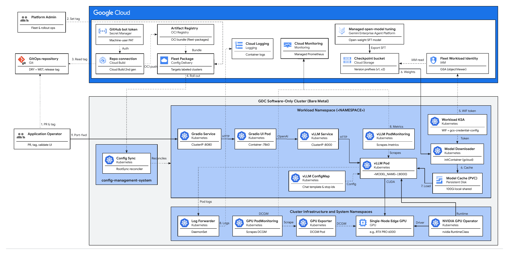

<!--
Copyright 2026 Google LLC

Licensed under the Apache License, Version 2.0 (the "License");
you may not use this file except in compliance with the License.
You may obtain a copy of the License at

    http://www.apache.org/licenses/LICENSE-2.0

Unless required by applicable law or agreed to in writing, software
distributed under the License is distributed on an "AS IS" BASIS,
WITHOUT WARRANTIES OR CONDITIONS OF ANY KIND, either express or implied.
See the License for the specific language governing permissions and
limitations under the License.
-->

# SFT model deployment using Fleet Packages on Distributed Cloud software only reference architecture

## Overview

This Solution Reference Architecture (SRA) defines the conceptual design,
component topology, and technical boundaries for automating the deployment and
lifecycle management of supervised fine-tuned (SFT) open-weight models on
[Distributed Cloud software only](https://docs.cloud.google.com/kubernetes-engine/distributed-cloud/bare-metal/docs)
bare-metal clusters using MLOps and GitOps practices.
[Google Cloud Config Delivery (Fleet Packages)](https://docs.cloud.google.com/kubernetes-engine/config-sync/docs/concepts/fleet-packages)
and
[Config Sync](https://docs.cloud.google.com/kubernetes-engine/config-sync/docs/overview)
roll out a versioned Kubernetes resource bundle from Git to every
[fleet](https://docs.cloud.google.com/kubernetes-engine/fleet-management/docs/fleet-concepts)
cluster that matches a target membership label so that each cluster serves the
model locally on its own GPU.

Enterprises that fine-tune open-weight models in Google Cloud—using
[managed open-model tuning in **Gemini Enterprise Agent Platform**](https://docs.cloud.google.com/gemini-enterprise-agent-platform/models/tuning/open-model-tuning)
(formerly Vertex AI; see the worked
[open-model SFT Jupyter notebook](https://github.com/GoogleCloudPlatform/generative-ai/blob/main/open-models/fine-tuning/get_started_with_oss_tuning_on_vertexai.ipynb))
or custom training pipelines—often need to serve those models at the edge, close
to their data, with the same release discipline applied to application code.
This architecture applies to any open-weight model supported by
[vLLM](https://github.com/vllm-project/vllm) for single-GPU inference, such as
Llama 3.1 8B, Gemma, Mistral, or Qwen checkpoints, running on a customer-sourced
single-node GPU for edge inference (such as an NVIDIA L4, L40S, RTX
4000/5000/6000 Ada, or RTX PRO 6000 Blackwell GPU). In this solution, the model
weights stay, for instance, in
[Cloud Storage](https://docs.cloud.google.com/storage/docs/introduction), and
Git carries only manifests and the model version that each release selects.

<!-- prettier-ignore -->
> [!IMPORTANT]
> SRA versus SRI scope. This document covers the architectural design and
> structural decisions. For the deployment manifests and step-by-step deployment
> and implementation instructions, see the [Solution Reference Implementation
> (SRI)](docs/reference-implementation.md). For detailed user instructions on
> how to use and demonstrate the solution capabilities, see the [Solution User
> Guide (SUG)](docs/user-guide.md).

<!-- prettier-ignore -->
> [!WARNING]
> **Disclaimer:** This is not an officially supported Google product. This
> project and solution guide are provided for architectural evaluation,
> reference, and educational purposes only, on a best-effort basis, with no
> official support and no service level agreement (SLA), and are not eligible
> for the [Google Open Source Software Vulnerability Rewards
> Program](https://bughunters.google.com/open-source-security). This solution
> does not include model weights: you must obtain any model you deploy yourself
> and comply with its upstream license (for example, the [Llama 3.1 Community
> License](https://www.llama.com/llama3_1/license/) and [Llama 3.1 Acceptable
> Use Policy](https://www.llama.com/llama3_1/use-policy/) for Llama 3.1
> derivatives). Organizations planning a deployment must independently analyze,
> test, and validate all sizing, availability, security, and operational
> considerations against their specific production requirements.

### Features and capabilities

- **Fleet-wide GitOps delivery:** A `FleetPackage` managed by the **Platform
  Administrator** in Config Delivery reads an immutable release tag from the
  customer's GitOps repository through a
  [Cloud Build](https://docs.cloud.google.com/build/docs/overview) repository
  connection and progressively rolls the bundle out to fleet memberships
  selected by label.
- **Declarative drift correction:** Config Sync applies the packaged manifests
  through a `RootSync` on each cluster and automatically reverts manual cluster
  edits, giving the **Platform Administrator** consistent state enforcement
  across the fleet.
- **Model version selection in Git:** The **Application Operator** selects the
  checkpoint in Git through `MODEL_VERSION` and `MODEL_GCS_URI` in the vLLM
  `Deployment` and cuts a SemVer release tag (`vX.Y.Z`) that pins the manifests,
  serving configuration, and model version together.
- **Version-scoped local model cache:** On pod startup, an initContainer pulls
  the selected checkpoint from Cloud Storage into
  `/model-cache/<MODEL_NAME>/<MODEL_VERSION>` on a `100Gi` local
  `PersistentVolumeClaim` and skips the copy when that version is already
  cached, keeping restarts fast for **Application Operators** even if wide-area
  connectivity is degraded.
- **Local OpenAI-compatible serving API:** vLLM serves `/v1/chat/completions`
  and `/v1/models` inside the cluster under a stable `<MODEL_NAME>` identifier
  and versioned aliases (`<MODEL_NAME>-vX.Y.Z` and `<MODEL_NAME>-vN`), allowing
  **Application Operators** and in-cluster workloads to target either the active
  model stream or an explicit release.
- **Application and GPU observability:** **Platform Administrators** and
  **Application Operators** monitor inference health through a workload
  `PodMonitoring` resource that sends vLLM metrics to
  [Google Cloud Managed Service for Prometheus](https://docs.cloud.google.com/monitoring/kubernetes-engine/prometheus)
  in
  [Cloud Monitoring](https://docs.cloud.google.com/monitoring/docs/monitoring-overview),
  a cluster GPU `PodMonitoring` resource (`dcgm-gmp`) that scrapes hardware
  telemetry from [NVIDIA DCGM Exporter](https://github.com/NVIDIA/dcgm-exporter)
  (see
  [Send GPU metrics to Cloud Monitoring](https://docs.cloud.google.com/kubernetes-engine/distributed-cloud/bare-metal/docs/how-to/gpu-metrics)),
  and container logs forwarded to
  [Cloud Logging](https://docs.cloud.google.com/logging/docs/overview).
- **Interactive validation:** A lightweight
  [Gradio](https://github.com/gradio-app/gradio) chat web UI calls the vLLM
  `Service` inside the cluster so that **Application Operators** can
  interactively verify each newly promoted or rolled-back release through port
  forwarding.

### Architectural principles

- **Git is the single source of truth:** Every workload object on the cluster
  comes from a reviewed pull request in the customer's GitOps repository; Config
  Sync drift correction enforces it continuously.
- **Releases are immutable:** An SFT model release is a Git tag created after
  the pull request merges, and the `FleetPackage` `tag` field pins the exact
  release that runs across the fleet.
- **Weights never enter Git:** Manifests reference model checkpoints by Cloud
  Storage URI; the initContainer downloads weights at pod start, keeping both
  the GitOps repository and the Config Delivery bundle small.
- **Keyless identity and zero cluster-resident secrets:** Workloads authenticate
  to Cloud Storage through keyless
  [Fleet Workload Identity](https://docs.cloud.google.com/kubernetes-engine/fleet-management/docs/use-workload-identity)
  (built on
  [Workload Identity Federation](https://docs.cloud.google.com/iam/docs/workload-identity-federation))
  using short-lived projected Kubernetes service account tokens and a non-secret
  audience `ConfigMap`, while the Git repository bot credential is stored
  exclusively in
  [**Google Cloud Secret Manager**](https://docs.cloud.google.com/secret-manager/docs/overview)
  and read only by Cloud Build in Google Cloud. **No static service account keys
  or manually created Kubernetes `Secret` objects exist on the cluster.** If an
  organization extends the deployment with components that consume runtime
  secrets (such as an API gateway credential or private registry pull secret),
  those secrets should be synchronized dynamically from Google Cloud Secret
  Manager using [External Secrets Operator](https://external-secrets.io/) rather
  than created manually on the cluster.
- **Least privilege end to end:** Beyond keyless workload identity scoped to
  `roles/storage.objectViewer` on the checkpoint bucket, the Config Delivery
  service agent receives a namespace-scoped `Role` on `RootSync` objects in
  `config-management-system` instead of `cluster-admin`, the Config Sync
  reconciler can be restricted via `RootSync.spec.override.roleRefs` to the
  resource kinds in the bundle, and a dedicated machine-user (bot) account with
  read-only access authorizes the Cloud Build repository connection.
- **Data stays in the cluster boundary:** Inference prompts and responses travel
  only between internal `ClusterIP` Services inside the bare-metal cluster.

## Architecture and design

### Components

Workload resources deploy into a configurable target Kubernetes namespace
(`<NAMESPACE>`, defaulting to `sft-model-serving` in the sample manifests).
Organized by architectural layer, the solution consists of five top-level
components:

- **Edge cluster infrastructure (customer managed):**
  - **Distributed Cloud software only standalone cluster:** Bare-metal
    Kubernetes cluster registered to a fleet in the customer's Google Cloud
    project, with Config Sync enabled and the target `<NAMESPACE>` onboarded.
  - **Single-node edge inference GPU:** Customer-sourced hardware accelerator
    dedicated to the serving pod, for example an NVIDIA L4, L40S, RTX
    4000/5000/6000 Ada, or RTX PRO 6000 Blackwell GPU.
  - **[NVIDIA GPU Operator](https://docs.nvidia.com/datacenter/cloud-native/gpu-operator/latest/index.html)
    and [NVIDIA DCGM Exporter](https://github.com/NVIDIA/dcgm-exporter):**
    Manages GPU drivers and container runtime hooks on the bare-metal node,
    exposes `nvidia.com/gpu` capacity and the `nvidia` `RuntimeClass`, and
    exports hardware GPU metrics on the cluster.
- **GitOps delivery pipeline (Google Cloud, `<REGION>`):**
  - **GitOps repository:** Customer-owned Git repository holding DRY
    [Kustomize](https://github.com/kubernetes-sigs/kustomize) sources
    (`fleet-package/src/`) and rendered plain-KRM WET manifests
    (`fleet-package/environments/default/`), initialized from scratch or seeded
    from the reference sample in `GoogleCloudPlatform/gdc-solutions`.
  - **Cloud Build repository connection (2nd gen) and Secret Manager:**
    Read-only link to the GitOps repository in `<REGION>`, authorized by a
    dedicated machine-user (bot) credential stored in Google Cloud Secret
    Manager via the Cloud Build GitHub App installation scoped to that
    repository.
  - **Publisher service account and
    [Artifact Registry](https://docs.cloud.google.com/artifact-registry/docs/overview)
    bundle store:** Per-solution service account used by Config Delivery's
    managed Cloud Build trigger to package the rendered variant directory into
    an immutable OCI artifact in the managed `fleet-packages` Artifact Registry
    repository.
  - **`FleetPackage` (Config Delivery):** Declarative Google Cloud resource that
    selects the repository, environment path, SemVer `tag`, and `default`
    variant, and rolls releases out across matching labeled memberships
    (`maxConcurrent: 1`).
  - **Config Delivery service agent and Config Sync reconciler:** The Config
    Delivery service agent manages `RootSync` objects in
    `config-management-system` under a namespace-scoped `Role` and `RoleBinding`
    (`configdelivery-rootsync-manager`), while the Config Sync reconciler
    applies the 9-resource bundle and can optionally be restricted to the
    packaged resource kinds using Server-Side Apply on
    `RootSync.spec.override.roleRefs` (verify field ownership behavior across an
    upgrade rollout in your cluster environment).
- **vLLM model serving engine:**
  - **vLLM `Deployment`:** Single-replica `Deployment` (`strategy: Recreate`,
    `runtimeClassName: nvidia`, `nvidia.com/gpu: 1`) running
    `vllm/vllm-openai:<VLLM_VERSION>` (validated with `v0.32.0`), loading
    weights from the local cache volume, and serving OpenAI-compatible HTTP
    endpoints on port `8000`.
  - **Model downloader `initContainer`:** Copies the checkpoint at
    `MODEL_GCS_URI` into `/model-cache/<MODEL_NAME>/<MODEL_VERSION>` unless
    `.complete` and all required checkpoint files already exist, writes
    `.complete` after verification, and deletes older version directories.
  - **vLLM `ConfigMap`:** Mounted read-only at `/etc/vllm/config` to provide the
    model's [Jinja](https://jinja.palletsprojects.com/) chat template and
    `generation_config.json` (stop token IDs and sampling defaults) under Git
    version control.
  - **Workload `ServiceAccount` and per-cluster credential `ConfigMap`:**
    Workload `ServiceAccount` mapped through Fleet Workload Identity to a
    read-only Google service account, paired with `ConfigMap`
    `gcs-credential-config` (`fleet-package/gcs-credential-config.yaml`) applied
    once per cluster during onboarding so the packaged `default` bundle stays
    100% cluster-agnostic across the fleet.
  - **Model cache storage:** `PersistentVolumeClaim` (`100Gi`, `ReadWriteOnce`,
    `StorageClass` `local-shared`) mounted at `/model-cache`, paired with a
    `16Gi` memory-backed `emptyDir` mounted at `/dev/shm`.
  - **vLLM `ClusterIP` `Service`:** Internal Kubernetes `Service` exposing the
    vLLM OpenAI-compatible HTTP server on port `8000` within `<NAMESPACE>`.
- **Gradio interactive validation UI:**
  - **Gradio `Deployment`:** Single-replica web application
    (`us-docker.pkg.dev/google-samples/containers/gke/gradio-app:v1.0.4`) on
    container port `7860` that sends chat completion requests to
    `http://<vllm-service>:8000/v1/chat/completions` using the release model
    alias.
  - **Gradio `ClusterIP` `Service`:** Internal Kubernetes `Service` on port
    `8080` (targeting container port `7860`) reached by Application Operators
    via `kubectl port-forward`.
- **Google Cloud integration:**
  - **Cloud Storage checkpoint bucket:** Customer bucket storing immutable
    fine-tuned model checkpoints organized by version prefix (for example
    `.../checkpoints/v1/` and `.../checkpoints/v2/`).
  - **Cloud Monitoring and Cloud Logging:** `PodMonitoring` resources scrape
    vLLM `/metrics` and NVIDIA DCGM Exporter GPU telemetry (`dcgm-gmp`) into
    Google Cloud Managed Service for Prometheus, and cluster log forwarders ship
    container logs to Cloud Logging.

### High-level architecture overview

The following diagram shows the GitOps release path (1)–(4) and the runtime,
observability, and validation path (5)–(9):

1. **Pull request and release tag (`1. PR & tag`):** An **Application Operator**
   opens a pull request in the **GitOps repository** updating the DRY Kustomize
   sources and committing the rendered WET bundle in the same pull request,
   merges after review, and pushes the immutable SemVer release tag `vX.Y.Z`.
2. **Set target release tag (`2. Set tag`):** Having applied the one-time
   per-cluster Config Delivery RBAC (`configdelivery-rootsync-manager`) and
   Fleet Workload Identity credential `ConfigMap` (`gcs-credential-config`)
   during cluster onboarding, the **Platform Administrator** sets the
   `FleetPackage` `tag` field to `vX.Y.Z` in Config Delivery (`<REGION>`).
3. **Package and publish bundle (`3. Read tag`):** Authenticating with the
   machine-user token in Secret Manager (`Auth`), Config Delivery's managed
   Cloud Build job reads the tagged `default` variant directory through the
   2nd-gen **Repo connection** (`3. Read tag`), pushes the immutable OCI bundle
   to **Artifact Registry** (`fleet-packages`, `OCI push`), and registers the
   release (`Bundle`) on the `FleetPackage`.
4. **Fleet rollout and reconciliation (`4. Roll out`):** Config Delivery
   progressively rolls the release out (`maxConcurrent: 1`, `4. Roll out`) to
   fleet clusters matching the target membership label by updating the managed
   `RootSync` in `config-management-system`, and **Config Sync** reconciles
   (`Reconciles`) the 9-resource bundle into `<NAMESPACE>` while continuously
   remediating drift.
5. **Keyless token exchange (`5. WIF token`):** Using **Workload KSA** and the
   per-cluster `gcs-credential-config` `ConfigMap` (`Token`), **Model
   Downloader** (`initContainer`) exchanges its projected Kubernetes service
   account token through **Fleet Workload Identity** (`5. WIF token`) for
   short-lived `roles/storage.objectViewer` credentials (`IAM read`) on the
   Cloud Storage **Checkpoint bucket** storing SFT weights exported
   (`Export SFT`) from **Managed open-model tuning** in Gemini Enterprise Agent
   Platform.
6. **Checkpoint download and caching (`6. Weights`, `6. Cache`):** **Model
   Downloader** copies the selected checkpoint prefix (`6. Weights`) from Cloud
   Storage into `/model-cache/<MODEL_NAME>/<MODEL_VERSION>` on the `100Gi`
   `local-shared` **Model Cache (PVC)** (`6. Cache`)—skipping the download if
   `.complete` and all required files are already verified—and prunes older
   cached versions.
7. **GPU model loading and serving (`7. Load`):** **vLLM Pod** (`<MODEL_NAME>`)
   loads the cached weights from **Model Cache (PVC)** (`7. Load`) onto the
   **Single-Node Edge GPU** (`CUDA`) through the **NVIDIA GPU Operator**
   (`nvidia` `RuntimeClass`, `Runtime`, `Driver`), mounts the chat template and
   stop token IDs from **vLLM ConfigMap** (`Config`), and serves
   OpenAI-compatible HTTP endpoints behind **vLLM Service** (`ClusterIP :8000`).
8. **Metrics scraping and log forwarding (`8. Metrics`, `8. Logs`):** **vLLM
   PodMonitoring** scrapes `/metrics` from **vLLM Pod** (`Scrapes`,
   `8. Metrics`) and **GPU PodMonitoring** (`dcgm-gmp`) scrapes **GPU Exporter**
   (`Scrape`, `DCGM`) into **Cloud Monitoring** (Managed Service for
   Prometheus), while the cluster **Log Forwarder** `DaemonSet` streams
   container logs (`Pod logs`, `8. Logs`) to **Cloud Logging**.
9. **Interactive release validation (`9. Port-fwd`):** An **Application
   Operator** accesses **Gradio Service** (`ClusterIP :8080`) over
   `kubectl port-forward` (`9. Port-fwd`), forwarding requests (`HTTP`) to
   **Gradio UI Pod** (`Container :7860`), which sends chat completion calls
   (`OpenAI`, `HTTP`) through **vLLM Service** to **vLLM Pod**.

### Hardware constraints

The architecture is GPU-model agnostic across single-node NVIDIA data center and
workstation GPUs supported by Distributed Cloud software only and the NVIDIA GPU
Operator—for example, **NVIDIA L4 (24 GB)**, **NVIDIA L40S (48 GB)**, **NVIDIA
RTX 4000 / 5000 / 6000 Ada (20–48 GB)**, or **NVIDIA RTX PRO 6000 Blackwell (96
GB)**. Because the serving pod claims one whole GPU without multi-GPU tensor
parallelism, operators must size model parameter count, numerical precision,
maximum context window (`--max-model-len`), and concurrency (`--max-num-seqs`)
to fit the VRAM budget of their target edge GPU.

For solution testing and validation, an **NVIDIA RTX PRO 6000 Blackwell GPU (96
GB GDDR7 with ECC)** was used to serve an **8B-parameter BF16 SFT checkpoint**
(validated with Llama 3.1 8B SFT). The following analysis illustrates the sizing
methodology that operators should repeat for their own GPU and model
combination:

- **Illustrative accelerator profile:** NVIDIA RTX PRO 6000 Blackwell
  (`97,887 MiB`, or about `95.6 GiB` total VRAM with ECC enabled), dedicated
  exclusively to the vLLM pod (`nvidia.com/gpu: 1`).
- **Illustrative model selection and KV-cache budget:**
  - **Weights footprint:** An unquantized 8B BF16 checkpoint occupies
    `16,060,556,376` bytes (about `14.96 GiB`) across safetensors shards,
    avoiding quantization loss on high-memory GPUs.
  - **Per-token KV cache:** With grouped-query attention (`2` for K and V × `32`
    layers × `8` KV heads × `128` head dimension × `2` bytes in BF16), each
    token consumes `128 KiB`, so one full `16,384`-token sequence
    (`--max-model-len=16384`) requires `2.0 GiB` of KV cache.
  - **96 GB GPU headroom (validation profile):** At
    `--gpu-memory-utilization=0.90` (`~86.0 GiB` reserved), subtracting
    `14.96 GiB` of weights and roughly `5 GiB` of CUDA and activation overhead
    leaves roughly `66 GiB` for the KV cache—sufficient for about `33`
    concurrent full-length `16,384`-token sequences (confirm exact available
    KV-cache headroom in your vLLM startup logs).
  - **48 GB GPU profile (for example, NVIDIA L40S or RTX 6000 Ada):** The same
    unquantized 8B BF16 checkpoint leaves roughly `20–25 GiB` of KV cache (`~10`
    full `16,384`-token sequences); tune `--max-model-len` or `--max-num-seqs`
    to prevent preemption under peak concurrency (validate concurrency under
    load on target 48 GB hardware).
  - **24 GB GPU profile (for example, NVIDIA L4 or RTX 4000 Ada):** Unquantized
    8B BF16 weights (`~15 GiB`) leave minimal headroom after runtime overhead;
    select a smaller SFT model (such as 2B–4B BF16), apply FP8 or INT4
    quantization, or cap `--max-model-len` tightly.
  - **Scale-up boundary:** Models exceeding single-GPU memory capacity even with
    quantization require multi-GPU tensor parallelism, which is outside the
    scope of this single-GPU reference architecture.

## Supportability matrix (responsibilities)

<!-- mdformat off -->

| Component                                                                              | Executed / Managed by | Notes                                                                                                                                                                                                                                                                                                                                                                                                                                                                                                                                                                                                                                                                                                         |
| :------------------------------------------------------------------------------------- | :-------------------- | :------------------------------------------------------------------------------------------------------------------------------------------------------------------------------------------------------------------------------------------------------------------------------------------------------------------------------------------------------------------------------------------------------------------------------------------------------------------------------------------------------------------------------------------------------------------------------------------------------------------------------------------------------------------------------------------------------------ |
| Physical bare-metal hardware and OS                                                    | Customer              | Customer-sourced server with a supported OS, local disk capacity, and one dedicated single-node edge inference GPU (such as NVIDIA L4, L40S, RTX Ada series, or RTX PRO 6000 Blackwell).                                                                                                                                                                                                                                                                                                                                                                                                                                                                                                                      |
| Distributed Cloud software only cluster installation and fleet registration            | Customer              | Installed and registered by the customer on version 1.35 or later; see [Distributed Cloud software only installation preparation](https://docs.cloud.google.com/kubernetes-engine/distributed-cloud/bare-metal/docs/installing/install-prep).                                                                                                                                                                                                                                                                                                                                                                                                                                                                 |
| NVIDIA GPU Operator, DCGM Exporter, and GPU drivers                                    | Customer              | Installed and maintained on the cluster by the customer (driver branch `580+` for CUDA 13 images such as `vllm/vllm-openai:v0.32.0`, validated with `580.126.20`, or branch `575–579` with `v0.32.0-cu129`); Google doesn't support the NVIDIA operator deployment. See [Configure GPUs on bare metal](https://docs.cloud.google.com/kubernetes-engine/distributed-cloud/bare-metal/docs/how-to/gpu-manual-use) and [Send GPU metrics to Cloud Monitoring](https://docs.cloud.google.com/kubernetes-engine/distributed-cloud/bare-metal/docs/how-to/gpu-metrics).                                                                                                                                             |
| Config Sync enablement and reconciliation                                              | Joint                 | Google provides and supports the managed fleet feature and Config Sync controller; the customer enables Config Sync on target clusters before the first rollout. See [Install Config Sync](https://docs.cloud.google.com/kubernetes-engine/config-sync/docs/how-to/installing-config-sync) and the [SRI](docs/reference-implementation.md).                                                                                                                                                                                                                                                                                                                                                                   |
| Config Delivery `FleetPackage`, Cloud Build connection, publisher SA, and cluster RBAC | Joint                 | Google operates the managed Config Delivery, Cloud Build, Artifact Registry, and Secret Manager services; the customer creates and configures the connection, `FleetPackage`, IAM bindings, and cluster RBAC. See [Fleet packages overview](https://docs.cloud.google.com/kubernetes-engine/config-sync/docs/concepts/fleet-packages) and [Connect to a GitHub repository](https://docs.cloud.google.com/build/docs/automating-builds/github/connect-repo-github).                                                                                                                                                                                                                                            |
| GitOps repository creation and release management                                      | Customer              | Customer creates and maintains their own GitOps repository (from scratch or seeded from the reference sample per the [SRI](docs/reference-implementation.md)) and owns pull request reviews and SemVer release tags.                                                                                                                                                                                                                                                                                                                                                                                                                                                                                          |
| Reference sample manifests (`software-only/bare-metal/sft-model-serving/`)             | Google (Solution)     | Reference code published in `GoogleCloudPlatform/gdc-solutions` under Apache 2.0, provided as is without official product support or SLA.                                                                                                                                                                                                                                                                                                                                                                                                                                                                                                                                                                     |
| Fine-tuned SFT checkpoint and Cloud Storage bucket                                     | Joint                 | Google operates [**Gemini Enterprise Agent Platform** managed open-model tuning](https://docs.cloud.google.com/gemini-enterprise-agent-platform/models/tuning/open-model-tuning) and [Cloud Storage](https://docs.cloud.google.com/storage/docs/introduction) infrastructure; the customer executes fine-tuning jobs (see the worked [Llama 3 / open-model SFT Jupyter notebook](https://github.com/GoogleCloudPlatform/generative-ai/blob/main/open-models/fine-tuning/get_started_with_oss_tuning_on_vertexai.ipynb)), validates model quality, complies with model licensing, and manages versioned bucket prefixes.                                                                                       |
| [vLLM](https://github.com/vllm-project/vllm) container image                           | Customer              | Upstream open source runtime (`vllm/vllm-openai:<VLLM_VERSION>`); the customer pins, vulnerability-scans, and optionally mirrors the image in [Artifact Registry](https://docs.cloud.google.com/artifact-registry/docs/overview).                                                                                                                                                                                                                                                                                                                                                                                                                                                                             |
| [Gradio](https://github.com/gradio-app/gradio) validation UI                           | Customer              | Interactive release validation tool operated by Application Operators, not a production serving front end.                                                                                                                                                                                                                                                                                                                                                                                                                                                                                                                                                                                                    |
| Cloud Logging and Cloud Monitoring                                                     | Joint                 | Google operates [Cloud Logging](https://docs.cloud.google.com/logging/docs/overview) and [Google Cloud Managed Service for Prometheus](https://docs.cloud.google.com/monitoring/kubernetes-engine/prometheus) in [Cloud Monitoring](https://docs.cloud.google.com/monitoring/docs/monitoring-overview); the customer enables application logging, workload `PodMonitoring` collection, and a `PodMonitoring` resource (`dcgm-gmp`) for [NVIDIA DCGM Exporter](https://github.com/NVIDIA/dcgm-exporter) GPU metrics on each cluster. See [Enable application logging and monitoring](https://docs.cloud.google.com/kubernetes-engine/distributed-cloud/bare-metal/docs/how-to/application-logging-monitoring). |

<!-- mdformat on -->

## Concepts and technologies

This section details the functional building blocks of the architecture,
abstracting deployment variables such as target `<NAMESPACE>`, `<REGION>`,
`<MODEL_NAME>`, GitOps repository layout, and GPU model selection.

### Infrastructure and platform

- **Fleet and labeled memberships:** Each bare-metal cluster is registered as a
  fleet membership in the customer's Google Cloud project. After a one-time
  per-cluster onboarding step (applying `Role/configdelivery-rootsync-manager`
  and the cluster's `gcs-credential-config` `ConfigMap`), membership labels
  control which clusters a `FleetPackage` targets, allowing new edge sites to
  join rollouts without modifying packaged workload manifests.
- **Dedicated single-node edge GPU:** One hardware GPU on the node is assigned
  exclusively to the serving pod (`nvidia.com/gpu: 1`). GPU partitioning (MIG)
  and time-slicing aren't used in this edge deployment scenario, ensuring
  predictable memory bandwidth and deterministic latency.
- **NVIDIA GPU Operator and DCGM Exporter:** Customer-managed cluster add-on
  that exposes `nvidia.com/gpu` scheduling resources, registers the `nvidia`
  `RuntimeClass` used by the serving pod, and publishes hardware telemetry for
  Cloud Monitoring.
- **Node-local model cache:** A `100Gi` `PersistentVolumeClaim` backed by the
  `local-shared` `StorageClass` retains downloaded checkpoints across pod
  restarts, node reboots, and configuration-only releases that keep
  `MODEL_VERSION` unchanged, decoupling steady-state inference from wide-area
  network availability.
- **Shared memory segment:** A `16Gi` memory-backed `emptyDir`
  (`medium: Memory`) mounted at `/dev/shm` provides the POSIX shared-memory
  segment required by PyTorch and vLLM worker processes.

### Services and logic

- **Model downloader `initContainer` and Fleet Workload Identity:** Uses the
  pinned [Google Cloud CLI](https://docs.cloud.google.com/sdk/docs/install)
  container image (`cloud-sdk`) to synchronize `MODEL_GCS_URI` into
  `/model-cache/<MODEL_NAME>/<MODEL_VERSION>` before the serving container
  starts:
  - **Keyless authentication:** Exchanges its projected Kubernetes service
    account JWT for short-lived Google Cloud credentials via
    `gcloud auth login --cred-file` using `ConfigMap` `gcs-credential-config`
    and logs the active Google service account identity. This
    [Fleet Workload Identity](https://docs.cloud.google.com/kubernetes-engine/fleet-management/docs/use-workload-identity)
    flow (`PROJECT_ID.svc.id.goog`) eliminates exported JSON keys, avoids
    cluster-local Kubernetes `Secret` objects, and requires no host-level
    service account credentials.
  - **Atomic cache verification:** Skips downloading only when the `.complete`
    marker and every required checkpoint artifact (`config.json`,
    `tokenizer.json`, `special_tokens_map.json`, and either
    `model.safetensors.index.json` or `model.safetensors` in
    [Hugging Face Safetensors](https://github.com/huggingface/safetensors)
    format) are verified on disk, writing `.complete` after verification so
    interrupted transfers retry cleanly on restart.
  - **Post-sync cache pruning:** Removes older version directories under
    `/model-cache/<MODEL_NAME>/` after activating the target version so disk
    usage stays bounded across upgrades.
- **vLLM serving engine:** Runs `vllm/vllm-openai:<VLLM_VERSION>`, pinned to an
  explicit upstream GA tag rather than `:latest` for deterministic GitOps
  rollouts (validated with `v0.32.0`, latest GA as of `2026-10-18`; clusters on
  NVIDIA driver branch `575–579` with CUDA 12.9 can use `v0.32.0-cu129`; verify
  on `575–579` hosts before rollout). Exposed internally on `ClusterIP` port
  `8000` with OpenAI-compatible endpoints (`/v1/chat/completions`, `/v1/models`,
  `/health`, `/metrics`), it configures six runtime groups:
  - **Local model path (`/model-cache/<MODEL_NAME>/$(MODEL_VERSION)`):** Loads
    weights directly from the node-local PVC.
  - **Served model aliases (`--served-model-name`):** Registers a stable stream
    name (`<MODEL_NAME>`), a full release alias (`<MODEL_NAME>-vX.Y.Z`), and a
    model-version alias (`<MODEL_NAME>-vN`).
  - **VRAM and batching profile (`--dtype`, `--tensor-parallel-size=1`,
    `--max-model-len`, `--gpu-memory-utilization`, `--max-num-seqs`):** Sized to
    the target GPU's memory budget (for example `bfloat16`, `16384`, `0.90`, and
    `256` on the 96 GB validation profile).
  - **Throughput optimizations (`--enable-prefix-caching`,
    `--enable-chunked-prefill`):** Reuse KV blocks across shared prompt prefixes
    and interleave long prefills with token decoding.
  - **Git-managed prompt and stop tokens (`--chat-template`,
    `--generation-config`):** Mount the SFT
    [Jinja](https://jinja.palletsprojects.com/) chat template and
    `generation_config.json` (`eos_token_id` and sampling defaults) from
    `/etc/vllm/config` so exported checkpoints without embedded template
    metadata stop cleanly (worked Llama 3.1 8B SFT details appear in the SRI).
  - **Code execution safety (`--trust-remote-code` omitted):** Runs native vLLM
    architectures without executing arbitrary Python code from checkpoint
    directories.
- **Gradio validation UI:** Exposed internally on `ClusterIP` port `8080`
  (container port `7860`), displaying the active release version in its header
  and sending `<MODEL_NAME>-vX.Y.Z` in API requests so Application Operators can
  visually confirm which release responds.

### Cloud observability integration

- **Application metrics via `PodMonitoring`:** A `monitoring.googleapis.com/v1`
  `PodMonitoring` resource scrapes vLLM's [Prometheus](https://prometheus.io/)
  `/metrics` endpoint every 15 seconds—capturing active requests,
  prompt/generation token throughput, time-to-first-token latency histograms,
  and KV-cache occupancy—and forwards samples to
  [Google Cloud Managed Service for Prometheus](https://docs.cloud.google.com/monitoring/kubernetes-engine/prometheus)
  when managed application collection (`enableGMPForApplications`) is enabled on
  the cluster. For cluster configuration steps, see
  [Enable application logging and monitoring](https://docs.cloud.google.com/kubernetes-engine/distributed-cloud/bare-metal/docs/how-to/application-logging-monitoring).
- **GPU hardware metrics via DCGM Exporter:**
  [NVIDIA DCGM Exporter](https://github.com/NVIDIA/dcgm-exporter) runs on GPU
  nodes to expose streaming multiprocessor utilization (`DCGM_FI_DEV_GPU_UTIL`),
  framebuffer memory used (`DCGM_FI_DEV_FB_USED`), temperature, power draw, and
  ECC error counters; Platform Administrators deploy a customer `PodMonitoring`
  resource (`dcgm-gmp`, selecting `app: nvidia-dcgm-exporter` on port `metrics`)
  in the exporter's namespace so Google Cloud Managed Service for Prometheus
  ships those metrics to Cloud Monitoring. For setup instructions, see
  [Send GPU metrics to Cloud Monitoring](https://docs.cloud.google.com/kubernetes-engine/distributed-cloud/bare-metal/docs/how-to/gpu-metrics).
- **Container logs in Cloud Logging:** Cluster log forwarders ship stdout/stderr
  streams from the model downloader `initContainer` (active Workload Identity
  principal, transfer progress, cache pruning), vLLM, and Gradio to Cloud
  Logging when application logging is enabled on the cluster; see
  [Enable application logging and monitoring](https://docs.cloud.google.com/kubernetes-engine/distributed-cloud/bare-metal/docs/how-to/application-logging-monitoring).

### Cloud Build and Config Delivery integration

- **2nd-gen Cloud Build connection and keyless cluster Git posture:** A regional
  2nd-gen Cloud Build repository connection links Config Delivery to the
  customer's GitOps repository using a dedicated read-only machine-user (bot)
  account whose OAuth credential is encrypted in Google Cloud Secret
  Manager—that is, no personal developer token is used, no Git credentials or
  Kubernetes `Secret` objects are distributed to edge clusters, and nothing in
  the delivery pipeline has write permission to push back to Git. See
  [Connect to a GitHub repository](https://docs.cloud.google.com/build/docs/automating-builds/github/connect-repo-github).
- **Managed Cloud Build packaging and Artifact Registry OCI bundles:** A
  `FleetPackage` in `<REGION>` specifies the linked repository, environment
  directory path (for example `fleet-package/environments` in a standalone
  GitOps repository, or
  `software-only/bare-metal/sft-model-serving/fleet-package/environments` when
  using the `gdc-solutions` directory layout), target Git `tag` (`vX.Y.Z`),
  variant (`default`), target fleet membership label selector, and rolling
  strategy (`maxConcurrent: 1`). Whenever a new `tag` is set, Config Delivery
  runs a managed Cloud Build job as the per-solution publisher service account
  (`roles/configdelivery.resourceBundlePublisher`,
  `roles/artifactregistry.writer`, `roles/logging.logWriter`), packages the
  pre-rendered plain-KRM variant folder without running Kustomize, stores the
  resulting immutable OCI bundle in the managed `fleet-packages` **Artifact
  Registry** repository in `<REGION>`, and registers the `ResourceBundle`
  release.
- **Fleet rollout orchestration and Config Sync reconciliation:** Config
  Delivery progressively writes or updates the managed `RootSync` object in
  `config-management-system` on each matching cluster using its service agent
  (`Role/configdelivery-rootsync-manager`), records rollout telemetry
  (`COMPLETED`, `IN_PROGRESS`, or `STALLED`), and hands off to Config Sync on
  each cluster to apply the 9-resource bundle and continuously remediate
  configuration drift.

## Considerations

Evaluate the following operational dimensions when sizing hardware, planning
maintenance windows, and hardening cluster security for your target deployment
environment.

### Scalability and performance

- **One GPU, one replica per cluster:** The vLLM `Deployment` runs a single
  replica holding `nvidia.com/gpu: 1`; horizontal serving capacity scales out
  across the fleet by onboarding and labeling additional bare-metal clusters
  (each pre-configured once with `gcs-credential-config` and receiving the
  identical 9-resource `default` bundle), rather than adding pod replicas on one
  single-GPU node.
- **Progressive blast-radius control:** `maxConcurrent: 1` rolls updates out to
  one cluster membership at a time, halting propagation at the first cluster if
  reconciliation fails.
- **Concurrency and KV-cache bounds:** `--max-num-seqs` caps concurrent
  sequences, while available VRAM above model weights bounds simultaneous
  long-context requests (for example, `~66 GiB` KV cache on a 96 GB GPU vs.
  `~20–25 GiB` on a 48 GB GPU for an 8B BF16 model).
- **Cold-start versus warm-start latency:** Promoting a new `MODEL_VERSION`
  downloads the checkpoint over HTTPS before vLLM starts (for example, `~15 GiB`
  for an 8B BF16 checkpoint), whereas configuration-only releases keeping the
  same `MODEL_VERSION` boot directly from the local PVC cache.

### Resource management

- **Workload container sizing:** Guaranteed QoS requests equal limits (`4` CPU,
  `32Gi` memory, `1` GPU in the 8B reference profile; adjust upward for larger
  models), while the Gradio validation pod requests `250m` CPU and `512Mi`
  memory (`500m` CPU limit).
- **Indicative bare-metal node sizing:** At least `16` vCPU, `64 GiB` RAM, and
  `250 GiB` fast local NVMe/SSD storage to accommodate the `100Gi` model cache
  PVC, container images, OS packages, and kubelet eviction thresholds (size CPU,
  memory, and NVMe capacity to your model and hardware SKU).
- **Self-pruning cache footprint:** Sizing the PVC so it holds the active
  checkpoint plus one incoming download allows atomic version transitions while
  post-sync pruning prevents unbounded disk growth across releases.
- **Eviction protection:** Neither workload tolerates
  `node.kubernetes.io/disk-pressure`; size node local storage with headroom so
  kubelet image or volume garbage collection never disrupts active serving.

### Availability and reliability

- **Planned single-GPU rollout window:** Because two pods can't simultaneously
  claim a single dedicated GPU, `strategy: Recreate` terminates the running pod
  before starting the replacement pod, introducing a brief serving pause during
  upgrades and rollbacks.
- **Offline restart resilience:** Once `.complete` is written for the active
  `MODEL_VERSION`, pod or node restarts reload weights directly from local
  storage without requiring Cloud Storage connectivity.
- **Immutable forward-release rollback:** Rolling back creates a forward SemVer
  tag (for example `v2.0.1`) pointing `MODEL_VERSION` and `MODEL_GCS_URI` back
  to the prior checkpoint prefix—or re-points
  `resourceBundleSelector.cloudBuildRepository.tag` on the `FleetPackage` to the
  prior release tag while its Cloud Storage prefix remains intact. Because older
  versions are pruned from `/model-cache`, rollback re-downloads the prior
  checkpoint (measured at `~782 MiB/s` inside a `24`-second download-and-prune
  step, `~3` minutes without serving, and `5` minutes `21` seconds from
  `FleetPackage` update to `Ready` for a `15 GiB` checkpoint on the earlier lab
  source before the vLLM image update).
- **Automated drift remediation:** Manual `kubectl` edits or accidental
  deletions of managed resources inside `<NAMESPACE>` are automatically reverted
  by Config Sync.
- **Cluster un-labeling and re-onboarding:** Removing the target membership
  label triggers foreground deletion of the managed `RootSync` and `<NAMESPACE>`
  (including the local cache PVC and per-cluster `gcs-credential-config`
  `ConfigMap`). Re-onboarding that cluster later requires re-applying the
  namespace and `gcs-credential-config` `ConfigMap` before re-applying the fleet
  label.

### Operational complexity

- **Reviewable DRY-to-WET release workflow:** Authors edit DRY Kustomize
  manifests, run `render.sh` locally, and commit both DRY and rendered WET YAML
  in the same pull request before merging, tagging, and updating `FleetPackage`
  (optionally add a pull-request CI check verifying `render.sh` leaves zero
  diff).
- **SemVer tag discipline:** Config Delivery requires bare three-part SemVer
  tags (`vX.Y.Z`). Customers who initialize a dedicated per-solution GitOps
  repository isolate release tags naturally; customers who host multiple
  solutions in one shared repository pair
  `resourceBundleSelector.cloudBuildRepository.path` subfolder isolation with
  disjoint SemVer major ranges.
- **CLI-driven operations:** Distributed Cloud software only exposes no cloud
  console UI for edge model endpoints; operators manage rollouts and diagnostics
  using `gcloud`, `kubectl`, Cloud Monitoring, and Cloud Logging.
- **GitOps repository lifecycle:** This solution assumes the customer creates
  and maintains their own GitOps repository—seeded from the sample manifests in
  `GoogleCloudPlatform/gdc-solutions` or initialized from scratch following the
  SRI—so release history, branch protection, and environment parameters belong
  entirely to the customer's MLOps lifecycle.

### Security and compliance

- **Least-privilege cluster RBAC:** Cluster access is separated across two
  distinct identities. First, the Google Cloud Config Delivery service agent
  only invokes `get`, `patch`, and `delete` on `rootsyncs.configsync.gke.io` in
  `config-management-system`, so onboarding grants it a narrow namespace-scoped
  `Role` and `RoleBinding` (`configdelivery-rootsync-manager`) rather than
  `cluster-admin`. Second, the in-cluster Config Sync reconciler applies the 9
  cluster-agnostic resources in the `default` bundle (`Namespace`,
  `ServiceAccount`, vLLM `ConfigMap`, `PersistentVolumeClaim`, two `Deployment`
  objects, two `Service` objects, and `PodMonitoring`); operators requiring
  strict tenant isolation can bind `RootSync.spec.override.roleRefs` via
  Server-Side Apply under a dedicated field manager so field ownership coexists
  cleanly with Config Delivery's `rollouts-manager` (verify across an upgrade
  rollout in your environment and re-apply if the `RootSync` is recreated).
- **Zero static secrets on clusters or in Git:** Fleet Workload Identity
  exchanges projected Kubernetes tokens for short-lived Cloud Storage read
  tokens (`roles/storage.objectViewer`), the per-cluster `gcs-credential-config`
  `ConfigMap` contains only non-secret STS audience metadata, and the Git
  machine-user credential stays in Google Cloud Secret Manager for Cloud Build.
  Neither Git repositories nor edge clusters store static secrets.
- **Cluster-internal network exposure:** Both vLLM (`:8000`) and Gradio
  (`:8080`) use internal `ClusterIP` Services without external ingress. Operator
  validation uses RBAC-gated `kubectl port-forward`; production external
  exposure requires adding an authenticating API gateway and TLS termination.
- **Request logging privacy:** Enabling `--enable-log-requests` on vLLM writes
  prompt metadata/content to container stdout and Cloud Logging; omit or
  restrict request logging when prompts contain regulated or personal data.
- **Pinned container provenance:** All runtime images (`vllm-openai`,
  `gradio-app`, and `cloud-sdk`) are pinned to explicit version tags; production
  deployments should vulnerability-scan images and mirror digests into a private
  Artifact Registry repository.

## Design decision

### Delivery mechanism: Config Delivery Fleet Packages versus standalone Config Sync RootSync versus manual kubectl apply

- **Selected option:** **Config Delivery `FleetPackage` with Config Sync**
- **Rationale:** Provides a single regional Google Cloud control plane resource
  (in any supported Google Cloud `<REGION>`, such as `us-central1`) that selects
  target bare-metal clusters by fleet label, orchestrates progressive
  blast-radius-controlled waves (`maxConcurrent: 1`), tracks per-cluster rollout
  status, and delegates continuous drift remediation on each cluster to Config
  Sync—without storing Git credentials on any edge cluster. The trade-off is
  regional dependency on Config Delivery, Cloud Build connections, and Artifact
  Registry during new release rollouts.
- **Alternatives rejected:**
  - _Standalone Config Sync (`RootSync` without `FleetPackage`):_ Simpler
    initial setup for a single standalone cluster because `RootSync` pulls
    directly from Git without Cloud Build or Artifact Registry packaging, **but
    across a multi-cluster edge fleet** every cluster requires its own Git
    authentication secret (or per-cluster credential lifecycle management),
    target version pins must be updated synchronously across all clusters or
    branches with **no progressive `maxConcurrent` canary wave**, and platform
    teams lose centralized fleet rollout history, health gating, and
    single-command rollout abort.
  - _Manual `kubectl apply`:_ Provides no Git audit trail, no drift remediation,
    and non-repeatable multi-site rollouts.

### Manifest rendering: WET bundle committed in the pull request versus CI hydration bot versus Kustomize in the variant folder

- **Selected option:** **Render the WET bundle locally (`render.sh`) and commit
  it alongside the DRY source change in the same pull request**
- **Rationale:** Config Delivery packages the variant directory verbatim without
  executing Kustomize, requiring plain KRM YAML in `environments/default/`.
  Committing rendered manifests in the pull request lets reviewers inspect exact
  resource diffs, ensures SemVer tags attach directly to human-reviewed commits,
  and requires zero Git write credentials in CI.
- **Alternatives rejected:**
  - _CI hydration bot pushing back to `main`:_ Requires write credentials,
    conflicts with protected branches, and introduces a race condition where
    release tags can land before bot commits finish.
  - _Placing `kustomization.yaml` directly in the variant directory:_ Causes
    Config Sync to parse `kind: Kustomization` as a Kubernetes API object and
    fail reconciliation with `KNV2010`.

### Release and version selection: SemVer tags in the GitOps repository versus slash-prefixed tags versus CI-published resource bundle releases versus release branches

- **Selected option:** **Bare three-part SemVer tags (`vX.Y.Z`) in the
  customer's GitOps repository, with checkpoint version controlled by
  `MODEL_VERSION` and `MODEL_GCS_URI`**
- **Rationale:** Config Delivery's OCI bundler and release parser strictly
  enforce bare three-part SemVer tags (`v1.0.0`, `v2.0.0`, `v2.0.1`). Embedding
  `MODEL_VERSION` and `MODEL_GCS_URI` in the Git-tagged manifests atomically
  binds infrastructure configuration, serving flags, and model weights under one
  immutable identifier. Customers using a dedicated per-solution GitOps
  repository enjoy clean repository-wide SemVer tags; customers sharing one
  repository across multiple solutions combine
  `resourceBundleSelector.cloudBuildRepository.path` subfolder isolation with
  disjoint SemVer major ranges.
- **Alternatives rejected:**
  - _Slash-prefixed or prerelease tags (for example `sft-model-serving/v1.0.0`
    or `-rc1`):_ Rejected by Config Delivery's `upload-variants` OCI tag parser
    and `CreateRelease` validation.
  - _Direct CI `ResourceBundle` uploads bypassing Git tags:_ Requires custom CI
    pipelines and publisher credentials outside Config Delivery's native Cloud
    Build repository integration.
  - _Mutable release branches:_ Allow subsequent commits to silently alter what
    an existing release deploys, breaking immutability and auditability.

### Model weight distribution: Cloud Storage with a version-scoped PVC cache versus weights in Git or the bundle versus weights in the image versus Hugging Face at runtime

- **Selected option:** **Immutable checkpoints in Cloud Storage, synchronized by
  an `initContainer` into `/model-cache/<MODEL_NAME>/<MODEL_VERSION>` on a
  node-local PVC**
- **Rationale:** Keeps multi-gigabyte safetensors shards out of Git and OCI
  config bundles, prevents cross-version shard corruption via version-scoped
  subdirectories, survives restarts offline via the `.complete` marker check,
  and bounds disk consumption via post-sync pruning. The accepted trade-off is
  re-downloading weights whenever `MODEL_VERSION` changes (including rollbacks).
- **Alternatives rejected:**
  - _Weights committed to Git or Config Delivery bundles:_ Exceeds repository
    and OCI config bundle limits.
  - _Weights baked into container images:_ Couples multi-gigabyte weight
    rebuilds and pulls to container lifecycle updates.
  - _Pulling from external model hubs at runtime:_ Introduces external internet
    dependencies and third-party token secrets for proprietary fine-tuned
    weights.

### Cloud Storage credentials: Fleet Workload Identity versus service account key Secret versus node credentials

- **Selected option:** **Fleet Workload Identity with a per-cluster
  `gcs-credential-config` `ConfigMap` applied once during cluster onboarding**
- **Rationale:** Provides short-lived, automatically rotated OIDC token exchange
  scoped strictly to `<NAMESPACE>` and `roles/storage.objectViewer`, storing
  zero secrets on the cluster without relying on host-level service account
  keys. Applying `fleet-package/gcs-credential-config.yaml` once per cluster at
  onboarding isolates the cluster-specific membership audience string so the
  packaged `environments/default/manifests.yaml` bundle remains 100% identical
  across all target clusters.
- **Alternatives rejected:**
  - _Embedding `gcs-credential-config.yaml` inside the shared `FleetPackage`
    bundle:_ Hard-codes one cluster's membership ID, breaking token exchange on
    every other cluster in the fleet.
  - _Exported Google service account JSON key in a Kubernetes `Secret`:_
    Introduces long-lived static credentials on edge nodes requiring manual
    rotation.
  - _Node-wide default credentials:_ Violates least privilege by exposing bucket
    access to every pod scheduled on the node.

### Cluster RBAC for Config Delivery: least-privilege roles versus cluster-admin

- **Selected option:** **Namespace-scoped `Role` and `RoleBinding`
  (`configdelivery-rootsync-manager`) in `config-management-system` for the
  Config Delivery service agent, plus optional `RootSync.spec.override.roleRefs`
  scoping for the Config Sync reconciler**
- **Rationale:** Grants the external Google Cloud service agent access solely to
  `rootsyncs.configsync.gke.io` in `config-management-system`, removing
  `cluster-admin` blast radius while allowing optional SSA reconciler scoping
  that coexists cleanly with Config Delivery's `rollouts-manager` field manager.
- **Alternatives rejected:**
  - _Cluster-wide `cluster-admin` for the Config Delivery service agent:_ Grants
    full cluster administrative privileges for an integration that touches only
    a single namespaced CRD.
  - _Unscoped `cluster-admin` reconciler in strict multi-tenant clusters:_
    Allows compromised manifests in a repository to mutate arbitrary
    cluster-scoped resources.

### Model serving runtime: vLLM versus Triton Inference Server versus Ollama

- **Selected option:** **Upstream [vLLM](https://github.com/vllm-project/vllm)
  OpenAI-compatible server (`vllm/vllm-openai:<VLLM_VERSION>`)**
- **Rationale:** Loads standard
  [Hugging Face Safetensors](https://github.com/huggingface/safetensors)
  BF16/FP8 SFT checkpoints directly from disk without weight conversion,
  delivers high single-GPU throughput via PagedAttention continuous batching and
  prefix caching, accepts explicit [Jinja](https://jinja.palletsprojects.com/)
  chat templates and `generation_config.json` stop-token overrides for SFT
  models, exposes standard OpenAI `/v1/chat/completions` endpoints, and exports
  rich native [Prometheus](https://prometheus.io/) `/metrics`.
- **Alternatives rejected:**
  - _[NVIDIA Triton Inference Server](https://github.com/triton-inference-server/server):_
    Introduces model-repository scaffolding, backend wrapper configuration, and
    higher operational complexity unnecessary for single-model edge serving.
  - _[Ollama](https://github.com/ollama/ollama):_ Convenient for desktop
    prototyping, but centers on GGUF conversion/packaging rather than native
    Hugging Face Safetensors SFT outputs from cloud tuning pipelines, exposes
    finer-grained batching/KV-cache and SFT stop-token controls less directly,
    and lacks native OpenMetrics serving telemetry out of the box.

### Telemetry collection: Google Cloud Managed Service for Prometheus versus a local Prometheus stack

- **Selected option:**
  **[Google Cloud Managed Service for Prometheus](https://docs.cloud.google.com/monitoring/kubernetes-engine/prometheus)
  (`PodMonitoring` for vLLM and
  [NVIDIA DCGM Exporter](https://github.com/NVIDIA/dcgm-exporter))**
- **Rationale:** Uses managed Prometheus collectors on Distributed Cloud
  software only to scrape both workload `PodMonitoring` targets (vLLM
  `/metrics`) and cluster GPU `PodMonitoring` targets (`dcgm-gmp` for NVIDIA
  DCGM Exporter) into
  [Cloud Monitoring](https://docs.cloud.google.com/monitoring/docs/monitoring-overview),
  providing unified fleet-wide dashboards and alerting without running a full
  Prometheus storage server on single-node edge hosts.
- **Alternatives rejected:**
  - _Self-managed local [Prometheus](https://prometheus.io/) and
    [Grafana](https://github.com/grafana/grafana) stack per cluster:_ Consumes
    local compute and storage resources on single-node edge servers, fragments
    fleet observability across isolated endpoints, and adds ongoing upgrade and
    retention maintenance.

## Assumptions and limitations

### Assumptions

- **Cluster:** Distributed Cloud software only for bare metal 1.35 or later
  (validated on Kubernetes `v1.35.2-gke.300`), standalone cluster registered to
  a fleet in the customer's Google Cloud project.
- **GPU node:** One dedicated single-node edge inference GPU per target cluster,
  with NVIDIA GPU Operator, `nvidia` `RuntimeClass`, NVIDIA DCGM Exporter, and a
  compatible NVIDIA driver installed (branch `580+` for default CUDA 13 vLLM
  images such as `v0.32.0`, validated on `580.126.20`, or a matching CUDA tag
  for earlier driver branches).
- **Config Sync:** Enabled on target fleet clusters before the first rollout.
- **Google Cloud APIs and regional placement:** Config Delivery, Anthos Config
  Management (Config Sync), Cloud Build, **Artifact Registry** (required because
  Config Delivery's managed Cloud Build packaging job pushes each packaged
  variant OCI bundle to the `fleet-packages` repository in `<REGION>`—created
  automatically when publishing a `FleetPackage` release—in addition to optional
  private container image mirroring), Secret Manager, GKE Hub, and Cloud Storage
  APIs are enabled. The Cloud Build connection and `FleetPackage` reside in the
  same supported Google Cloud `<REGION>` (for example `us-central1`).
- **GitOps repository:** The customer initializes and maintains their own GitOps
  repository (seeded from the sample in `GoogleCloudPlatform/gdc-solutions` or
  created from scratch per the SRI) and connects it via a 2nd-gen Cloud Build
  repository connection authorized by a dedicated machine-user (bot) account.
- **Network path:** Target clusters reach Google Cloud APIs
  (`*.googleapis.com`), Cloud Storage, and container registries over outbound
  HTTPS (`443`).
- **Checkpoint layout:** Merged SFT checkpoints (`config.json`,
  `tokenizer.json`, `special_tokens_map.json`, safetensors shard(s), and
  optional tokenizer/generation files) reside in immutable version prefixes in
  Cloud Storage.
- **Required roles and permissions:**
  - Publisher service account (one per solution):
    `roles/configdelivery.resourceBundlePublisher`,
    `roles/artifactregistry.writer`, and `roles/logging.logWriter`.
  - Cloud Build service agent
    (`service-PROJECT_NUMBER@gcp-sa-cloudbuild.iam.gserviceaccount.com`):
    `roles/secretmanager.admin` so 2nd-gen connection setup can store the
    machine-user OAuth token in Secret Manager.
  - Workload Google service account: `roles/storage.objectViewer` on the
    checkpoint bucket, plus `roles/iam.workloadIdentityUser` bound to
    `serviceAccount:PROJECT_ID.svc.id.goog[<NAMESPACE>/<KSA_NAME>]`.
  - Config Delivery service agent: namespace-scoped `Role` and `RoleBinding`
    (`configdelivery-rootsync-manager`) on `rootsyncs.configsync.gke.io` in
    `config-management-system` on each target cluster, applied alongside the
    per-cluster `gcs-credential-config` `ConfigMap` during onboarding; Config
    Sync reconciler optionally scoped via `RootSync.spec.override.roleRefs`
    (verify across an upgrade rollout in your environment and re-apply if the
    `RootSync` is recreated).
  - Platform Administrator: permissions to manage fleet memberships/labels,
    `FleetPackage` resources, Cloud Build connections, IAM bindings, and cluster
    onboarding RBAC.
  - Application Operator: write access to the GitOps repository (pull requests
    and tags) plus Kubernetes RBAC in `<NAMESPACE>` (`get`/`list` pods and
    Services, pod logs, `pods/portforward`, and `pods/exec`).

### Limitations

- **Single-GPU serving boundary:** Supports one replica claiming one single-node
  GPU per cluster; multi-GPU tensor or pipeline parallelism is out of scope.
- **Brief downtime on release restarts:** `strategy: Recreate` stops the running
  vLLM pod before starting the new pod, interrupting inference for roughly `2–4`
  minutes during upgrades or rollbacks (longer over slow WAN links when
  downloading a new `MODEL_VERSION`).
- **Rollback re-downloads weights:** Because cache pruning retains only the
  active `MODEL_VERSION`, rolling back re-downloads the prior checkpoint from
  Cloud Storage (`5` minutes `21` seconds update-to-`Ready` in lab testing on
  the earlier lab source before the vLLM image update) and requires keeping
  historical checkpoint prefixes in the bucket.
- **Node-local volume affinity:** The `local-shared` PVC binds the serving pod
  to the specific bare-metal node holding the volume.
- **Validation-only UI:** Gradio provides no built-in user authentication and is
  intended solely for operator validation over `kubectl port-forward`.
- **Reference support model:** Reference manifests are provided under Apache 2.0
  without an SLA; vLLM and Gradio follow their upstream open source support
  lifecycles.

## What's next

- [Solution Reference Implementation (SRI)](docs/reference-implementation.md):
  step-by-step instructions to initialize the GitOps repository, onboard
  clusters, and deploy release `v1.0.0`.
- [Solution User Guide (SUG)](docs/user-guide.md): interactive Gradio
  validation, application and GPU monitoring, upgrading from `v1.0.0` to
  `v2.0.0`, and forward rollback.
- [Fleet packages overview](https://docs.cloud.google.com/kubernetes-engine/config-sync/docs/concepts/fleet-packages)
- [Open model serving on Distributed Cloud software only reference architecture](https://docs.cloud.google.com/kubernetes-engine/distributed-cloud/bare-metal/docs/solutions/open-model-serving-sw-only)
